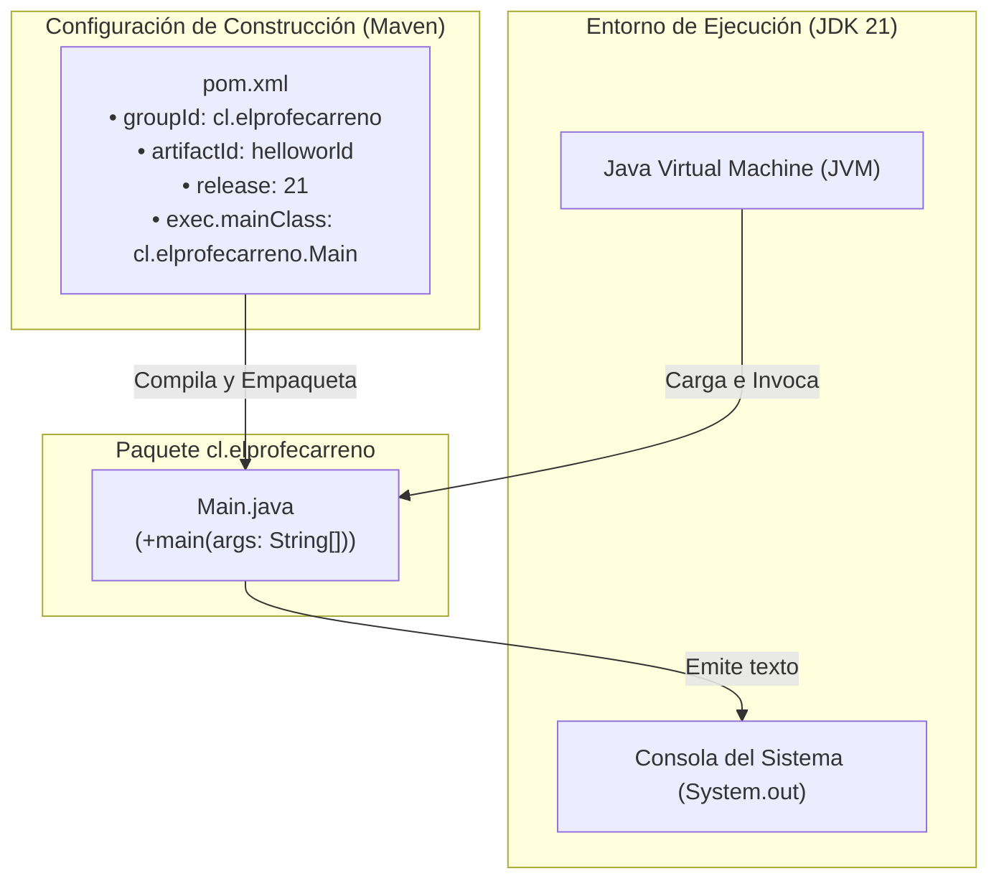
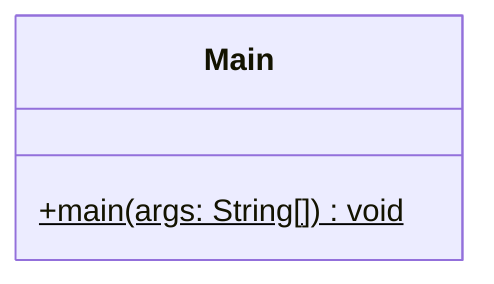
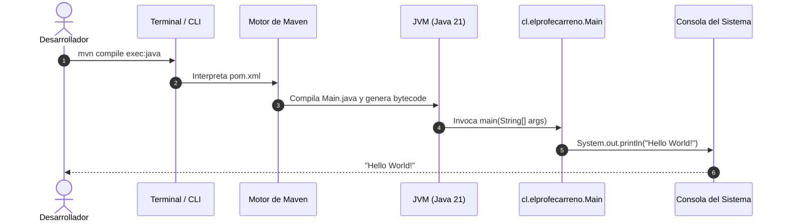

# Proyecto 01 - poo-fundaments (Entorno Base y Hola Mundo con Maven)

Este proyecto corresponde a la **introducción e inicialización del entorno de desarrollo** para aplicaciones en Java utilizando **Apache Maven** y **JDK 21**. Constituye el **punto de partida (Hito 01)** de una serie de 15 proyectos incrementales enfocados en los fundamentos de la Programación Orientada a Objetos (POO), arquitectura de software, modelado de dominio y persistencia en memoria.

El objetivo pedagógico principal es verificar la correcta instalación del compilador de Java, la configuración de variables de entorno (`JAVA_HOME`, `PATH`), el gestor de dependencias Maven y la ejecución satisfactoria del clásico programa de bienvenida por consola.

*Video de apoyo:* [Primer Proyecto Hello World!!!](https://youtu.be/CBQbfG04zjU)

---

## ¿Qué hace el proyecto?

La clase principal `Main` contiene el punto de entrada de la aplicación (`public static void main(String[] args)`). Al compilarse y ejecutarse, invoca el flujo estándar de salida del sistema (`System.out.println`) para imprimir en consola el mensaje:

```text
Hello World!
```

Este proceso valida que la máquina virtual de Java (JVM) y el compilador `javac` interactúen sin errores con el archivo descriptor de Maven (`pom.xml`).

---

## Punto de Partida Incremental

Al ser el **Proyecto 01**, establece los cimientos sobre los cuales se incorporarán progresivamente abstracción, encapsulamiento, relaciones de asociación/composición, herencia, polimorfismo, colecciones y el ciclo CRUD completo:

| Aspecto | Implementación en Proyecto 01 | Propósito en la Serie Incremental |
| :--- | :--- | :--- |
| **Arquitectura** | Monolítica básica / Clase única ejecutable | Validar la compilación, empaquetado y ejecución mediante Maven. |
| **Entrada / Salida** | Salida estandarizada por consola (`System.out.println`) | Establecer el canal de retroalimentación inicial antes de integrar interacción con el usuario vía `Scanner`. |
| **Modelo de Dominio** | Sin entidades ni clases de negocio | Punto cero previo a la definición de abstracción y encapsulamiento en `Persona`. |
| **Configuración Maven** | `pom.xml` con Java 21 y propiedad `exec.mainClass` | Configurar los metadatos del proyecto y el comando de ejecución estándar con `exec-maven-plugin`. |

---

## Diagrama de Componentes

El siguiente diagrama ilustra la estructura de empaquetado del proyecto y su interacción con el entorno de ejecución de Java:



---

## Diagrama de Clases



---

## Diagrama de Flujo e Interacción

El siguiente diagrama de secuencia detalla el ciclo de vida de la ejecución desde la terminal:



---

## Paso a Paso para la Construcción del Proyecto

A continuación se detalla la guía técnica para reproducir este proyecto desde cero:

### Paso 1: Configurar el archivo de compilación `pom.xml`
Crea el archivo `pom.xml` en la raíz del proyecto indicando el estándar de Java 21 y la clase principal ejecutable:

```xml
<?xml version="1.0" encoding="UTF-8"?>
<project xmlns="http://maven.apache.org/POM/4.0.0" 
         xmlns:xsi="http://www.w3.org/2001/XMLSchema-instance" 
         xsi:schemaLocation="http://maven.apache.org/POM/4.0.0 http://maven.apache.org/xsd/maven-4.0.0.xsd">
    <modelVersion>4.0.0</modelVersion>
    <groupId>cl.elprofecarreno</groupId>
    <artifactId>helloworld</artifactId>
    <version>1.0-SNAPSHOT</version>
    <packaging>jar</packaging>
    <properties>
        <project.build.sourceEncoding>UTF-8</project.build.sourceEncoding>
        <maven.compiler.release>21</maven.compiler.release>
        <exec.mainClass>cl.elprofecarreno.Main</exec.mainClass>
    </properties>
</project>
```

### Paso 2: Crear la clase principal `Main.java`
En la ruta `src/main/java/cl/elprofecarreno/Main.java`, implementa el método `main`:

```java
package cl.elprofecarreno;

public class Main {

    public static void main(String[] args) {
        System.out.println("Hello World!");
    }
}
```

---

## Estructura del Proyecto

```text
01/
├── README.md
└── helloworld/
    ├── pom.xml
    └── src/
        └── main/
            └── java/
                └── cl/
                    └── elprofecarreno/
                        └── Main.java
```

---

## Requisitos y Ejecución

### Requisitos
- **Java JDK**: 21 (o superior).
- **Apache Maven**: 3.8 (o superior).
- **IDE recomendado**: Apache NetBeans, Visual Studio Code o IntelliJ IDEA.

### Ejecución desde la carpeta del proyecto
```bash
cd 01/helloworld
mvn clean compile exec:java
```

### Ejecución desde la raíz del repositorio `poo-fundaments`
```bash
mvn -f 01/helloworld/pom.xml clean compile exec:java
```

### Resultado esperado en consola
```text
[INFO] Scanning for projects...
[INFO] --------------------------------[ jar ]---------------------------------
[INFO] --- exec:3.1.0:java (default-cli) @ helloworld ---
Hello World!
[INFO] ------------------------------------------------------------------------
[INFO] BUILD SUCCESS
[INFO] ------------------------------------------------------------------------
```

---

## Objetivos Pedagógicos y Buenas Prácticas

- **Verificación de Herramientas**: Garantizar que el compilador `javac` y Maven estén sincronizados en la misma versión de JDK.
- **Estructura Estándar de Maven**: Respetar la convención estándar de directorios `src/main/java/` y nomenclaturas de paquetes en minúsculas en reversa (`cl.elprofecarreno`).
- **Simplicidad**: Mantener el primer hito libre de dependencias externas para aislar posibles problemas de configuración de red o repositorios.
