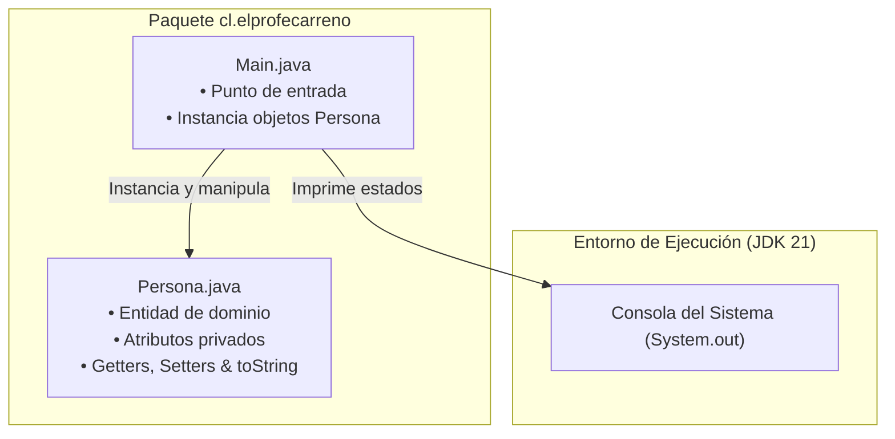
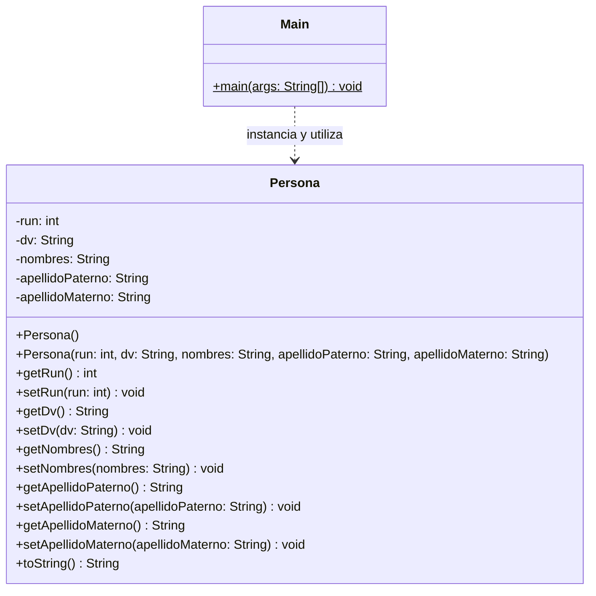
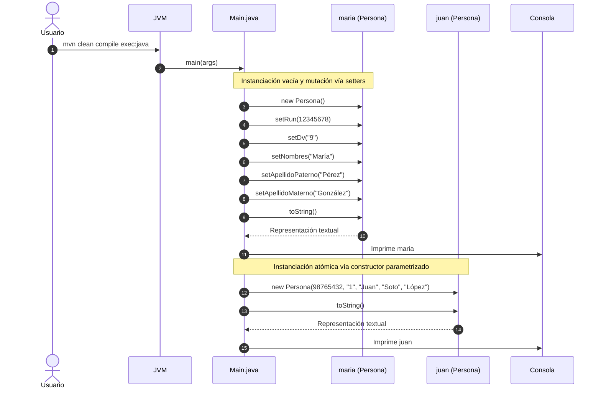

# Proyecto 02 - poo-fundaments (Abstracción y Encapsulamiento Básico)

Este proyecto aborda los dos primeros grandes pilares de la Programación Orientada a Objetos: **Abstracción** y **Encapsulamiento**. Constituye el **Hito 02** de la serie incremental, evolucionando desde la simple ejecución de texto del Hito 01 hacia el modelado formal de una entidad de negocio del mundo real (`Persona`).

El propósito pedagógico es comprender la separación entre los datos internos de un objeto (estado) y las operaciones públicas que permiten interactuar con él (comportamiento), protegiendo la integridad de la información mediante modificadores de acceso restrictivos.

*Video de apoyo:* [Abtracción y Encapsulamiento (POO)](https://youtu.be/dznHdkDOYi8)

---

## ¿Qué hace el proyecto?

1. Modela formalmente la entidad `Persona` con atributos privados que representan la identidad de un ciudadano chileno: RUN, dígito verificador, nombres y apellidos.
2. Expone métodos públicos de acceso y modificación (**getters y setters**) para cada uno de sus atributos, junto con un constructor por defecto y un constructor sobrecargado con parámetros.
3. Sobrescribe el método estándar `toString()` para entregar una representación legible del estado del objeto.
4. En `Main.java`, demuestra dos formas de instanciar y poblar objetos:
   - **Instanciación por defecto y mutación**: Crea a `maria` invocando el constructor vacío y asignando valores paso a paso con setters.
   - **Instanciación completa parametrizada**: Crea a `juan` pasando todos los argumentos directamente al constructor sobrecargado.
5. Imprime ambos objetos en la consola estándar del sistema.

---

## Diferencias Clave: Proyecto 02 vs. Proyecto 01

| Componente / Concepto | Proyecto 01 | Proyecto 02 | Beneficio / Justificación |
| :--- | :--- | :--- | :--- |
| **Modelo de Datos** | Sin clases de modelo. | Introduce la clase de entidad `Persona`. | Permite representar entidades del mundo real en el software con tipos de datos adecuados. |
| **Encapsulamiento** | N/A (solo método estático `main`). | Atributos privados (`private`) accesibles únicamente vía métodos públicos (`public`). | Ocultamiento de la representación interna del objeto; evita alteraciones no autorizadas y sienta las bases para validaciones defensivas. |
| **Constructores** | Constructor implícito por defecto de Java. | Constructor vacío explícito y constructor parametrizado sobrecargado. | Flexibilidad para instanciar objetos vacíos o inicializarlos atómicamente con todos sus datos. |
| **Representación Textual** | Cadenas fijas *hardcodeadas*. | Sobrescritura de `toString()`. | Inspección depurada y rápida del estado interno de los objetos en consola o logs. |

---

## Diagrama de Componentes



---

## Diagrama de Clases



---

## Diagrama de Flujo e Interacción



---

## Paso a Paso para la Construcción Incremental (desde Proyecto 01)

### Paso 1: Configuración de `pom.xml`
Se actualiza el `artifactId` a `abstraccion-encapsulamiento` manteniendo JDK 21:

```xml
<?xml version="1.0" encoding="UTF-8"?>
<project xmlns="http://maven.apache.org/POM/4.0.0" 
         xmlns:xsi="http://www.w3.org/2001/XMLSchema-instance" 
         xsi:schemaLocation="http://maven.apache.org/POM/4.0.0 http://maven.apache.org/xsd/maven-4.0.0.xsd">
    <modelVersion>4.0.0</modelVersion>
    <groupId>cl.elprofecarreno</groupId>
    <artifactId>abstraccion-encapsulamiento</artifactId>
    <version>1.0-SNAPSHOT</version>
    <packaging>jar</packaging>
    <properties>
        <project.build.sourceEncoding>UTF-8</project.build.sourceEncoding>
        <maven.compiler.release>21</maven.compiler.release>
        <exec.mainClass>cl.elprofecarreno.Main</exec.mainClass>
    </properties>
</project>
```

### Paso 2: Crear la clase `Persona.java`
En `src/main/java/cl/elprofecarreno/Persona.java`, implementa los atributos privados y los métodos accesores:

```java
package cl.elprofecarreno;

public class Persona {

    private int run;
    private String dv;
    private String nombres;
    private String apellidoPaterno;
    private String apellidoMaterno;

    public Persona() {
    }

    public Persona(int run, String dv, String nombres, String apellidoPaterno, String apellidoMaterno) {
        this.run = run;
        this.dv = dv;
        this.nombres = nombres;
        this.apellidoPaterno = apellidoPaterno;
        this.apellidoMaterno = apellidoMaterno;
    }

    public int getRun() {
        return run;
    }

    public void setRun(int run) {
        this.run = run;
    }

    public String getDv() {
        return dv;
    }

    public void setDv(String dv) {
        this.dv = dv;
    }

    public String getNombres() {
        return nombres;
    }

    public void setNombres(String nombres) {
        this.nombres = nombres;
    }

    public String getApellidoPaterno() {
        return apellidoPaterno;
    }

    public void setApellidoPaterno(String apellidoPaterno) {
        this.apellidoPaterno = apellidoPaterno;
    }

    public String getApellidoMaterno() {
        return apellidoMaterno;
    }

    public void setApellidoMaterno(String apellidoMaterno) {
        this.apellidoMaterno = apellidoMaterno;
    }

    @Override
    public String toString() {
        return "Persona{" + "run=" + run + ", dv=" + dv + ", nombres=" + nombres 
                + ", apellidoPaterno=" + apellidoPaterno + ", apellidoMaterno=" + apellidoMaterno + '}';
    }
}
```

### Paso 3: Probar la clase en `Main.java`
En `src/main/java/cl/elprofecarreno/Main.java`:

```java
package cl.elprofecarreno;

public class Main {

    public static void main(String[] args) {
        Persona maria = new Persona();
        maria.setRun(12345678);
        maria.setDv("9");
        maria.setNombres("María");
        maria.setApellidoPaterno("Pérez");
        maria.setApellidoMaterno("González");
        System.out.println("maria: " + maria.toString());

        Persona juan = new Persona(98765432, "1", "Juan", "Soto", "López");
        System.out.println("juan: " + juan.toString());
    }
}
```

---

## Estructura del Proyecto

```text
02/
├── README.md
└── abstraccion-encapsulamiento/
    ├── pom.xml
    └── src/
        └── main/
            └── java/
                └── cl/
                    └── elprofecarreno/
                        ├── Main.java
                        └── Persona.java
```

---

## Requisitos y Ejecución

### Requisitos
- **Java JDK**: 21 (o superior).
- **Apache Maven**: 3.8 (o superior).

### Ejecución
```bash
cd 02/abstraccion-encapsulamiento
mvn clean compile exec:java
```

O desde la raíz de `poo-fundaments`:
```bash
mvn -f 02/abstraccion-encapsulamiento/pom.xml clean compile exec:java
```

### Resultado esperado en consola
```text
maria: Persona{run=12345678, dv=9, nombres=María, apellidoPaterno=Pérez, apellidoMaterno=González}
juan: Persona{run=98765432, dv=1, nombres=Juan, apellidoPaterno=Soto, apellidoMaterno=López}
```

---

## Objetivos Pedagógicos y Buenas Prácticas

- **Abstracción**: Identificar los atributos esenciales de una persona para el contexto del negocio, descartando información irrelevante.
- **Encapsulamiento y Ocultamiento**: Declarar variables de instancia con visibilidad `private` y suministrar métodos `get/set` controlados.
- **Sobrecarga de Métodos (Overloading)**: Diseñar múltiples constructores con distinta signatura para otorgar versatilidad al cliente de la clase.
- **Identidad vs. Estado**: Comprender que `maria` y `juan` son dos instancias independientes en memoria heap, cada una con su propio estado interno.
