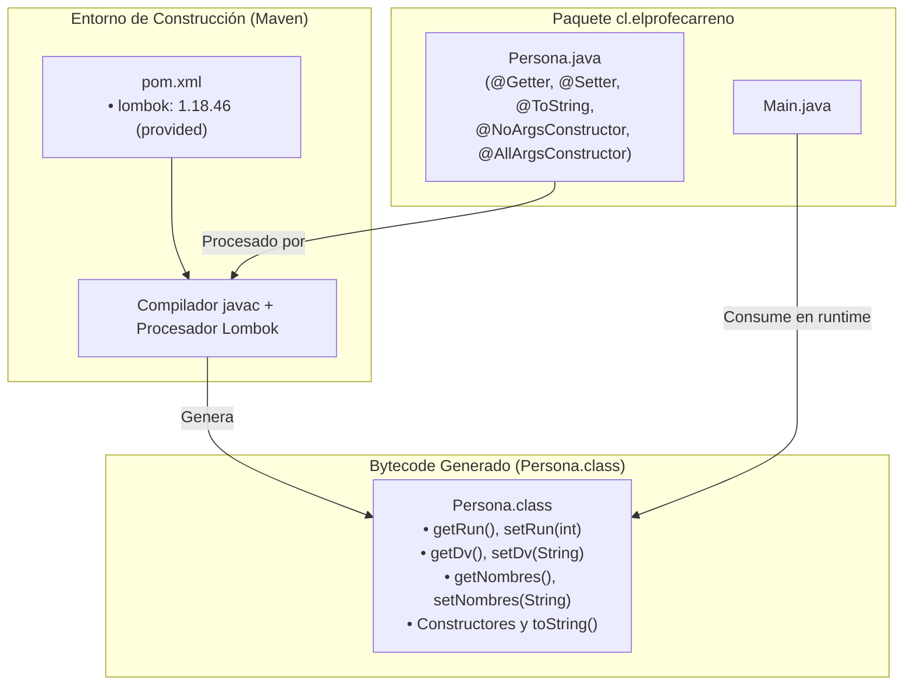
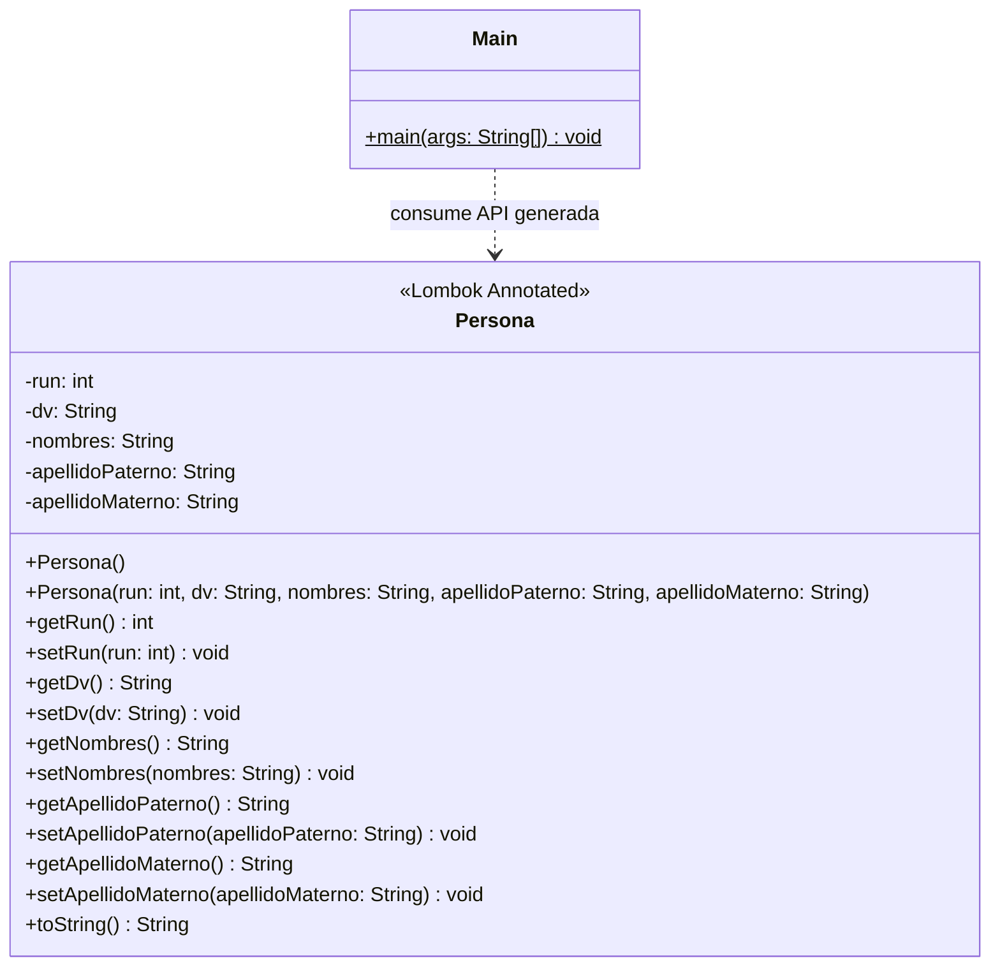
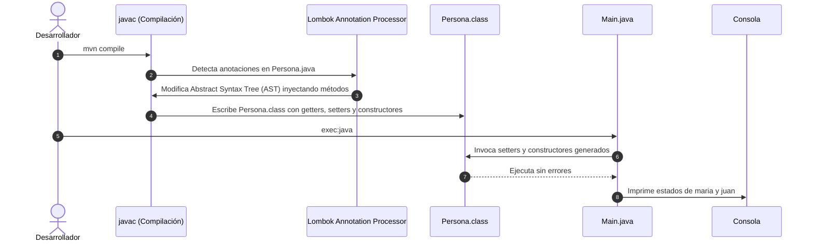

# Proyecto 03 - poo-fundaments (Encapsulamiento y Reducción de Boilerplate con Project Lombok)

Este proyecto introduce la biblioteca **Project Lombok**, una herramienta fundamental en el ecosistema profesional de Java para la generación automática de código repetitivo (*boilerplate*) en tiempo de compilación. Constituye el **Hito 03** de la serie incremental.

El objetivo pedagógico es enseñar cómo mantener un encapsulamiento estricto y todas las convenciones JavaBean sin sacrificar la legibilidad ni la mantenibilidad del código fuente, utilizando procesadores de anotaciones de Java.

*Video de apoyo:* [Abtracción y Encapsulamiento (POO) - Parte 2 lombok](https://youtu.be/bifiaIAJZbs)

---

## ¿Qué hace el proyecto?

1. Incorpora la dependencia `org.projectlombok:lombok` (versión `1.18.46`) en el descriptor Maven `pom.xml` con alcance `provided`.
2. Refactoriza la clase de entidad `Persona`, eliminando la escritura manual de más de 60 líneas de código repetitivo (getters, setters, constructores vacío y completo, y el método `toString()`).
3. Decora la clase con las anotaciones `@Getter`, `@Setter`, `@AllArgsConstructor`, `@NoArgsConstructor` y `@ToString`.
4. El compilador de Java (`javac`), apoyado por el procesador de anotaciones de Lombok, genera automáticamente en el bytecode (`.class`) todos los métodos accesores y constructores equivalentes a los del Hito 02.
5. `Main.java` se ejecuta sin alterar una sola línea de código respecto al proyecto previo, validando que la API pública de la clase `Persona` se conserva intacta.

---

## Diferencias Clave: Proyecto 03 vs. Proyecto 02

| Componente / Concepto | Proyecto 02 | Proyecto 03 | Beneficio / Justificación |
| :--- | :--- | :--- | :--- |
| **Dependencias Externas** | Sin dependencias externas (Java puro). | Agrega **Project Lombok** 1.18.46 en `pom.xml` (`<scope>provided</scope>`). | Permite la generación de código en tiempo de compilación sin impactar el tamaño final del JAR en runtime. |
| **Código Fuente de `Persona`** | ~80 líneas de código manual (getters, setters, constructores). | ~20 líneas de código decorado con anotaciones. | Incrementa la legibilidad, reduce errores tipográficos al mantener campos y acelera el desarrollo. |
| **Evolución del Modelo** | Modificar o añadir un atributo requería crear manualmente sus métodos de acceso. | Basta con añadir la variable de instancia privada y Lombok genera automáticamente sus métodos. | Mayor agilidad y mantenibilidad ante cambios en el modelo de dominio. |
| **Compatibilidad con Clientes (`Main.java`)** | Consumía métodos explícitos. | Consume los mismos métodos inyectados en el bytecode. | Desacoplamiento: los consumidores de la clase no se ven afectados por la optimización interna. |

---

## Diagrama de Componentes



---

## Diagrama de Clases



---

## Diagrama de Flujo e Interacción



---

## Paso a Paso para la Construcción Incremental (desde Proyecto 02)

### Paso 1: Agregar la dependencia de Lombok en `pom.xml`
Edita `pom.xml` e introduce la sección `<dependencies>`:

```xml
<?xml version="1.0" encoding="UTF-8"?>
<project xmlns="http://maven.apache.org/POM/4.0.0" 
         xmlns:xsi="http://www.w3.org/2001/XMLSchema-instance" 
         xsi:schemaLocation="http://maven.apache.org/POM/4.0.0 http://maven.apache.org/xsd/maven-4.0.0.xsd">
    <modelVersion>4.0.0</modelVersion>
    <groupId>cl.elprofecarreno</groupId>
    <artifactId>abstraccion-encapsulamiento</artifactId>
    <version>1.0-SNAPSHOT</version>
    <packaging>jar</packaging>
    <properties>
        <project.build.sourceEncoding>UTF-8</project.build.sourceEncoding>
        <maven.compiler.release>21</maven.compiler.release>
        <exec.mainClass>cl.elprofecarreno.Main</exec.mainClass>
    </properties>
    <dependencies>
        <dependency>
            <groupId>org.projectlombok</groupId>
            <artifactId>lombok</artifactId>
            <version>1.18.46</version>
            <scope>provided</scope>
        </dependency>
    </dependencies>
</project>
```

### Paso 2: Refactorizar `Persona.java` con anotaciones Lombok
Reemplaza la implementación manual por anotaciones a nivel de clase:

```java
package cl.elprofecarreno;

import lombok.AllArgsConstructor;
import lombok.Getter;
import lombok.NoArgsConstructor;
import lombok.Setter;
import lombok.ToString;

@Getter
@Setter
@AllArgsConstructor
@NoArgsConstructor
@ToString
public class Persona {

    private int run;
    private String dv;
    private String nombres;
    private String apellidoPaterno;
    private String apellidoMaterno;
}
```

### Paso 3: Verificar `Main.java`
El código de `Main.java` permanece intacto, demostrando la transparencia de Lombok:

```java
package cl.elprofecarreno;

public class Main {

    public static void main(String[] args) {
        Persona maria = new Persona();
        maria.setRun(12345678);
        maria.setDv("9");
        maria.setNombres("María");
        maria.setApellidoPaterno("Pérez");
        maria.setApellidoMaterno("González");
        System.out.println("maria: " + maria.toString());

        Persona juan = new Persona(98765432, "1", "Juan", "Soto", "López");
        System.out.println("juan: " + juan.toString());
    }
}
```

---

## Estructura del Proyecto

```text
03/
├── README.md
└── abstraccion-encapsulamiento/
    ├── pom.xml
    └── src/
        └── main/
            └── java/
                └── cl/
                    └── elprofecarreno/
                        ├── Main.java
                        └── Persona.java
```

---

## Requisitos y Ejecución

### Requisitos
- **Java JDK**: 21 (o superior).
- **Apache Maven**: 3.8 (o superior).
- **IDE**: Soporte de Lombok habilitado (en NetBeans o IntelliJ, habilitar *Annotation Processing*).

### Ejecución
```bash
cd 03/abstraccion-encapsulamiento
mvn clean compile exec:java
```

O desde la raíz de `poo-fundaments`:
```bash
mvn -f 03/abstraccion-encapsulamiento/pom.xml clean compile exec:java
```

### Resultado esperado en consola
```text
maria: Persona(run=12345678, dv=9, nombres=María, apellidoPaterno=Pérez, apellidoMaterno=González)
juan: Persona(run=98765432, dv=1, nombres=Juan, apellidoPaterno=Soto, apellidoMaterno=López)
```

---

## Objetivos Pedagógicos y Buenas Prácticas

- **Procesamiento de Anotaciones**: Comprender cómo las librerías pueden intervenir en el ciclo de compilación para enriquecer el Abstract Syntax Tree (AST) sin alterar el código fuente manualmente.
- **Alcance `provided`**: Entender que Lombok solo se necesita al compilar (`provided`); en tiempo de ejecución no añade peso ni sobrecarga a la JVM.
- **Legibilidad y Principio DRY (Don't Repeat Yourself)**: Reducir ruido sintáctico para centrar la atención del desarrollador en la lógica de negocio y las relaciones de dominio.
