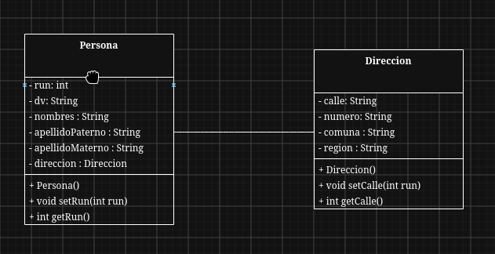
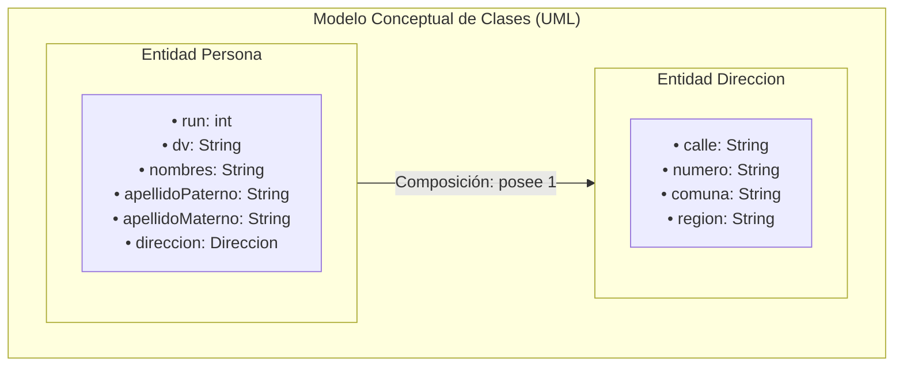
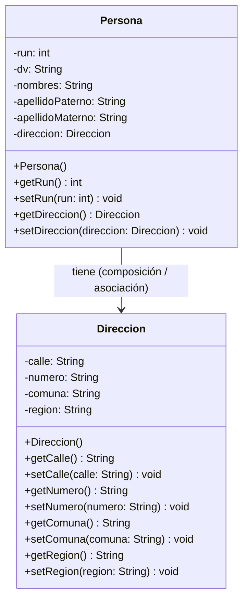

# Proyecto 04 - poo-fundaments (Diseño Conceptual y Diagrama de Clases: Composición y Asociación)

Este hito representa un paso metodológico esencial en la ingeniería de software: **el modelado conceptual y diseño de clases previo a la implementación**. Constituye el **Hito 04** de la serie incremental.

A diferencia de los demás hitos, esta carpeta no contiene código fuente Java ejecutable, sino los artefactos de diseño UML (específicamente la imagen `diagrama-clases.png`) que formalizan las relaciones estructurales entre entidades antes de codificarlas en el Hito 05.

*Video de apoyo:* [Abtracción y Encapsulamiento (POO) - Parte 3 Diagrama de Clases](https://youtu.be/k-t4vigvG28)

---

## ¿Qué hace el proyecto?

1. Introduce el concepto de **relaciones entre clases**: una entidad del mundo real rara vez existe de forma aislada; suele colaborar con otras entidades.
2. Modela formalmente la entidad **`Direccion`** con sus atributos constitutivos: `calle`, `numero`, `comuna` y `region`.
3. Establece la relación de **asociación / composición fuerte**: una `Persona` posee una referencia interna a un objeto de tipo `Direccion` (`direccion: Direccion`).
4. Proporciona el diagrama UML de referencia (`diagrama-clases.png`) como contrato de diseño que guiará el desarrollo en Java a partir del Proyecto 05.

#### Diagrama Conceptual del Dominio:


---

## Diferencias Clave: Proyecto 04 vs. Proyecto 03

| Componente / Concepto | Proyecto 03 | Proyecto 04 | Beneficio / Justificación |
| :--- | :--- | :--- | :--- |
| **Enfoque de Desarrollo** | Implementación directa en código (Code-First). | Diseño y modelado arquitectónico previo (Design-First). | Previene errores de acoplamiento y estructura antes de invertir tiempo en codificación. |
| **Relaciones entre Clases** | Entidad aislada (`Persona` contenía solo tipos primitivos y Strings). | Modela relaciones estructurales (**Asociación / Composición**). | Refleja la complejidad real del dominio, donde una persona habita en un lugar físico estructurado. |
| **Modularidad de Datos** | La dirección no existía o se habría modelado con múltiples Strings dispersos en `Persona`. | Se extrae la responsabilidad geográfica a una clase independiente `Direccion`. | **Principio de Responsabilidad Única (SRP)**: desacopla los datos de residencia de la identidad de la persona, permitiendo reutilizar `Direccion` en otras entidades (e.g. sucursales, empresas). |
| **Artefactos del Proyecto** | Código Java compilable (`.java`, `pom.xml`). | Diagrama UML estandarizado (`diagrama-clases.png`). | Documentación visual comprensible tanto para desarrolladores como para analistas de negocio. |

---

## Diagrama de Componentes y Dominio



---

## Diagrama de Clases (UML Formal)



---

## Análisis de Diseño Orientado a Objetos

### 1. ¿Por qué no colocar los atributos de dirección directamente en `Persona`?
Si colocáramos `calle`, `numero`, `comuna` y `region` dentro de `Persona`:
- Violamos el **Principio de Responsabilidad Única (SRP)**: `Persona` sabría de identidad ciudadana y también de geolocalización urbana.
- No podríamos reutilizar la lógica de direcciones en otros elementos del sistema.
- El objeto `Persona` se convertiría en una clase inflada (*God Class / Large Class*).

### 2. Relación de Composición vs. Agregación
En este modelo, la dirección representa el domicilio de la persona. La referencia `direccion` dentro de `Persona` materializa una relación de colaboración: para acceder a la comuna de una persona, navegamos a través de `persona.getDireccion().getComuna()`.

---

## Estructura del Directorio

```text
04/
├── README.md
└── diagrama-clases.png
```

---

## Requisitos y Visualización

Al ser un hito de diseño conceptual, no requiere comandos de compilación Maven:
- Visualiza el archivo `diagrama-clases.png` con cualquier visor de imágenes del sistema o directamente desde tu editor/IDE.
- La implementación práctica en código Java de este diseño se materializa en el [**Proyecto 05**](../05/README.md).

---

## Objetivos Pedagógicos y Buenas Prácticas

- **Modelado UML**: Familiarizarse con la notación de clases, visibilidad de atributos (`-` privado, `+` público) y flechas de asociación.
- **Normalización de Objetos**: Descomponer estructuras complejas en objetos más pequeños, cohesivos y manejables.
- **Anticipación Arquitectónica**: Definir tipos de datos y responsabilidades antes de escribir la primera línea de código Java.
