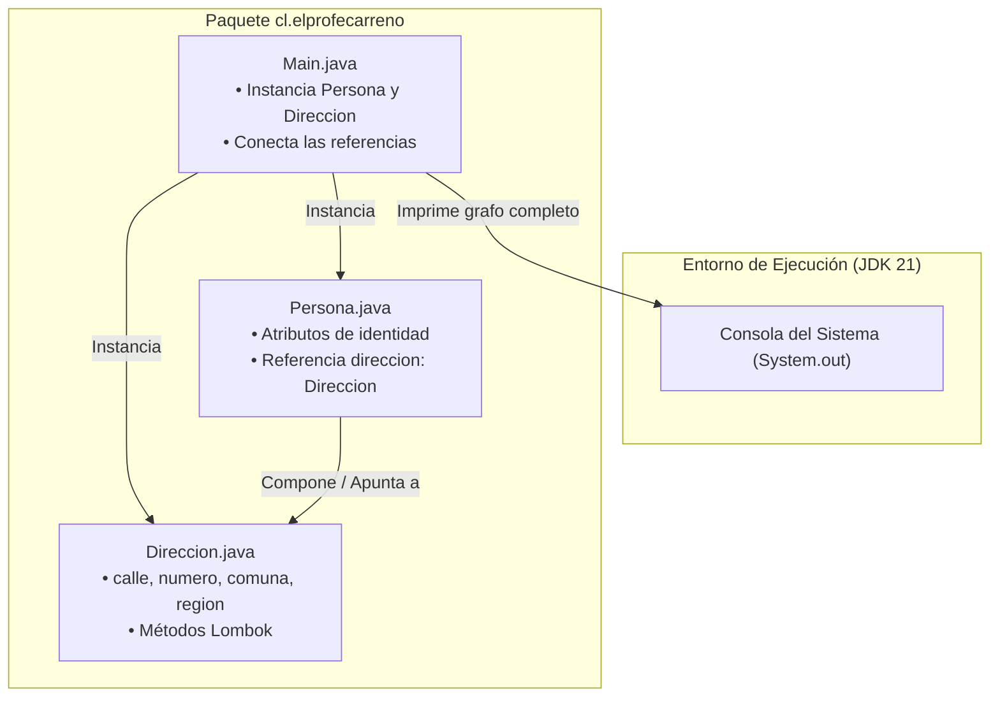
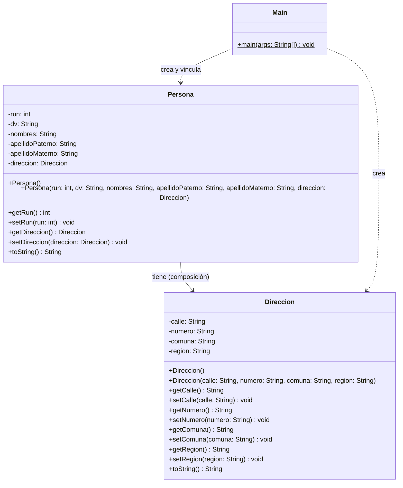
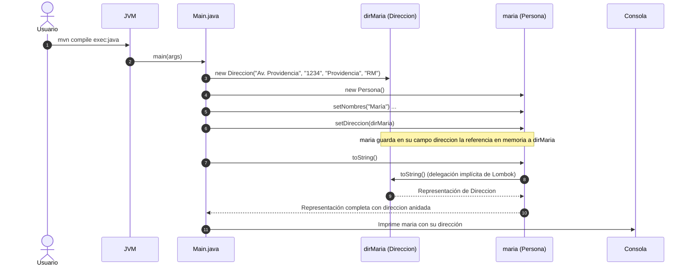

# Proyecto 05 - poo-fundaments (Composición de Clases: Persona con Dirección)

Este proyecto lleva a la práctica el diseño conceptual establecido en el Hito 04, implementando formalmente en Java la relación de **Composición y Colaboración entre Clases**. Constituye el **Hito 05** de la serie incremental.

El objetivo pedagógico principal es dominar la asociación de objetos en memoria: un objeto no solo contiene atributos de tipos primitivos (`int`, `boolean`) o cadenas (`String`), sino que puede contener referencias a instancias de otras clases de dominio (`Direccion`), formando grafos de objetos estructurados.

*Video de apoyo:* [Abtracción y Encapsulamiento (POO) - Parte 4 Colaboración o Composición de Clases](https://youtu.be/OSn6Iw2EnVc)

---

## ¿Qué hace el proyecto?

1. Crea la clase `Direccion.java` decorada con Lombok (`@Getter`, `@Setter`, `@AllArgsConstructor`, `@NoArgsConstructor`, `@ToString`), encapsulando `calle`, `numero`, `comuna` y `region`.
2. Modifica la clase `Persona.java` incorporando el atributo de tipo objeto `private Direccion direccion`.
3. En `Main.java`, demuestra la creación y vinculación de objetos asociados:
   - Instancia una `Direccion` independiente (`new Direccion("Av. Siempre Viva", "742", "Springfield", "Región Metropolitana")`).
   - Asigna dicha dirección a la instancia de `Persona` mediante `maria.setDireccion(direccion)`.
   - Demuestra la instanciación parametrizada completa para `juan`, pasando la instancia de dirección directamente en el constructor sobrecargado.
4. Al invocar `toString()`, se visualiza en consola la serialización en cascada generada por Lombok, mostrando los datos de la persona junto con su dirección anidada.

---

## Diferencias Clave: Proyecto 05 vs. Proyecto 03 / 04

| Componente / Concepto | Proyecto 03 / 04 | Proyecto 05 | Beneficio / Justificación |
| :--- | :--- | :--- | :--- |
| **Nueva Clase de Dominio** | Solo existía `Persona.java` (y el diagrama conceptual en el Hito 04). | Implementa `Direccion.java` con soporte de Lombok. | Materializa en código ejecutable la abstracción de domicilio diseñada previamente. |
| **Atributo Objeto en `Persona`** | `Persona` solo contenía datos primitivos y `String`. | Incorpora el campo `private Direccion direccion`. | Aplica el principio de **Composición de Objetos**: una persona "tiene una" (*has-a*) dirección. |
| **Instanciación y Enlace en Memoria** | Instanciación plana de variables individuales. | Creación de objetos colaboradores y vinculación de referencias (`setDireccion`). | Modela relaciones complejas en la memoria heap de la JVM mediante punteros/referencias a objetos. |
| **Representación Textual Anidada** | `Persona.toString()` mostraba solo datos personales. | `Persona.toString()` incluye automáticamente el `toString()` de `Direccion`. | Facilita la depuración integral del grafo de objetos desde una única instrucción de impresión. |

---

## Diagrama de Componentes



---

## Diagrama de Clases



---

## Diagrama de Flujo e Interacción



---

## Paso a Paso para la Construcción Incremental (desde Proyecto 03)

### Paso 1: Crear la clase `Direccion.java`
En `src/main/java/cl/elprofecarreno/Direccion.java`:

```java
package cl.elprofecarreno;

import lombok.AllArgsConstructor;
import lombok.Getter;
import lombok.NoArgsConstructor;
import lombok.Setter;
import lombok.ToString;

@Getter
@Setter
@AllArgsConstructor
@NoArgsConstructor
@ToString
public class Direccion {

    private String calle;
    private String numero;
    private String comuna;
    private String region;
}
```

### Paso 2: Actualizar `Persona.java` para incorporar `Direccion`
En `src/main/java/cl/elprofecarreno/Persona.java`, agrega la variable `direccion`:

```java
package cl.elprofecarreno;

import lombok.AllArgsConstructor;
import lombok.Getter;
import lombok.NoArgsConstructor;
import lombok.Setter;
import lombok.ToString;

@Getter
@Setter
@AllArgsConstructor
@NoArgsConstructor
@ToString
public class Persona {

    private int run;
    private String dv;
    private String nombres;
    private String apellidoPaterno;
    private String apellidoMaterno;
    private Direccion direccion;
}
```

### Paso 3: Vincular objetos en `Main.java`
En `src/main/java/cl/elprofecarreno/Main.java`:

```java
package cl.elprofecarreno;

public class Main {

    public static void main(String[] args) {
        Direccion dirMaria = new Direccion("Los Leones", "1020", "Providencia", "RM");
        Persona maria = new Persona();
        maria.setRun(12345678);
        maria.setDv("9");
        maria.setNombres("María");
        maria.setApellidoPaterno("Pérez");
        maria.setApellidoMaterno("González");
        maria.setDireccion(dirMaria);
        System.out.println("maria: " + maria.toString());

        Direccion dirJuan = new Direccion("Alameda", "340", "Santiago", "RM");
        Persona juan = new Persona(98765432, "1", "Juan", "Soto", "López", dirJuan);
        System.out.println("juan: " + juan.toString());
    }
}
```

---

## Estructura del Proyecto

```text
05/
├── README.md
└── abstraccion-encapsulamiento/
    ├── pom.xml
    └── src/
        └── main/
            └── java/
                └── cl/
                    └── elprofecarreno/
                        ├── Direccion.java
                        ├── Main.java
                        └── Persona.java
```

---

## Requisitos y Ejecución

### Requisitos
- **Java JDK**: 21 (o superior).
- **Apache Maven**: 3.8 (o superior).

### Ejecución
```bash
cd 05/abstraccion-encapsulamiento
mvn clean compile exec:java
```

O desde la raíz de `poo-fundaments`:
```bash
mvn -f 05/abstraccion-encapsulamiento/pom.xml clean compile exec:java
```

### Resultado esperado en consola
```text
maria: Persona(run=12345678, dv=9, nombres=María, apellidoPaterno=Pérez, apellidoMaterno=González, direccion=Direccion(calle=Los Leones, numero=1020, comuna=Providencia, region=RM))
juan: Persona(run=98765432, dv=1, nombres=Juan, apellidoPaterno=Soto, apellidoMaterno=López, direccion=Direccion(calle=Alameda, numero=340, comuna=Santiago, region=RM))
```

---

## Objetivos Pedagógicos y Buenas Prácticas

- **Relación "Tiene un" (*Has-a*)**: Modelar dependencias estructurales donde una entidad engloba a otra para expresar el dominio con fidelidad.
- **Navegabilidad de Objetos**: Acceder a atributos profundos mediante encadenamiento seguro de llamadas (`persona.getDireccion().getComuna()`).
- **Acoplamiento Cohesivo**: Dividir el modelo en clases con alta cohesión y bajo acoplamiento, listas para ser reutilizadas o ampliadas.
