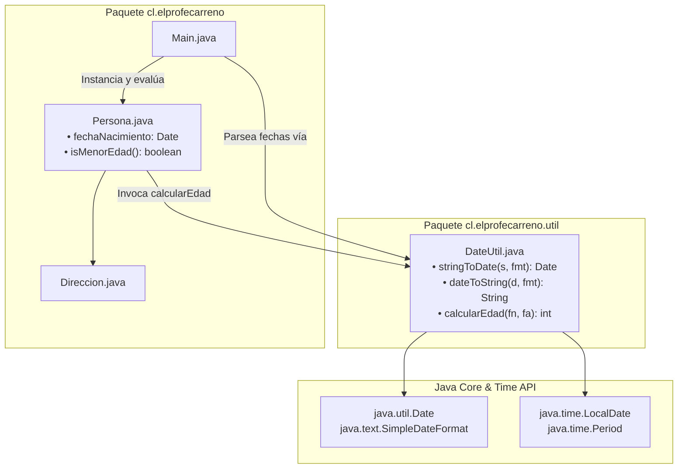
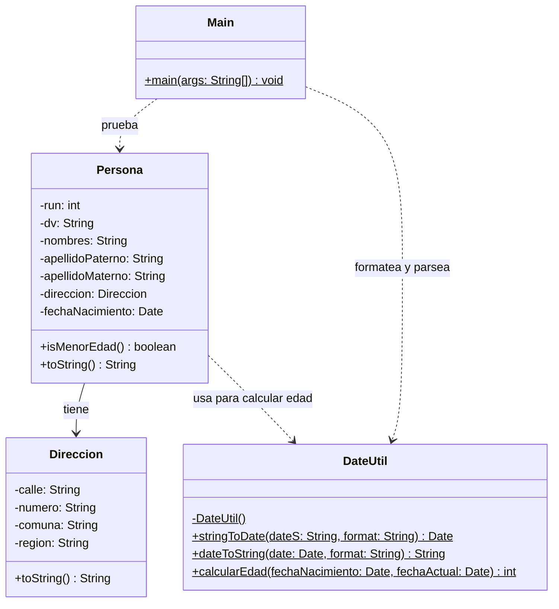
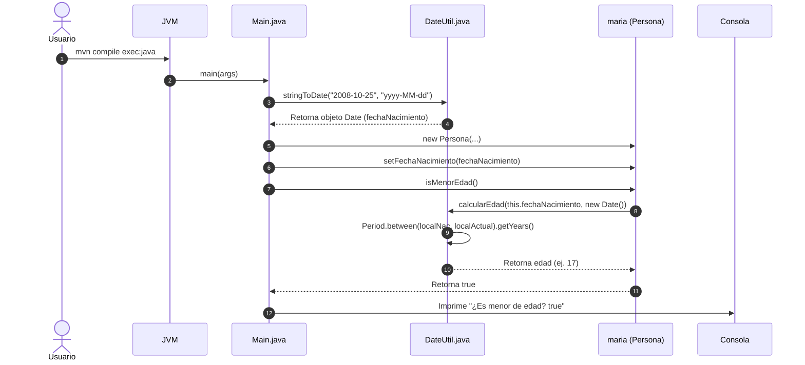

# Proyecto 06 - poo-fundaments (Clases Utilitarias y Manejo Temporal: DateUtil y Fechas)

Este proyecto introduce el diseño de **clases utilitarias (Utility Classes)** en Java y la gestión formal de fechas temporales, conversiones y cálculos cronológicos. Constituye el **Hito 06** de la serie incremental.

El objetivo pedagógico es dominar dos aspectos cruciales del desarrollo profesional:
1. El patrón de diseño para clases utilitarias estáticas (inmutabilidad, constructor privado no instanciable, métodos estáticos puros).
2. La interoperabilidad entre la API tradicional de fechas (`java.util.Date`, `java.text.SimpleDateFormat`) y la moderna API de fecha/tiempo de Java (`java.time.LocalDate`, `java.time.Period`) para el cálculo de edad de una persona.

*Video de apoyo:* [Abtracción y Encapsulamiento (POO) - Parte 5 Fechas y Librerias](https://youtu.be/aOBPgSGgiZU)

---

## ¿Qué hace el proyecto?

1. Crea el paquete utilitario `cl.elprofecarreno.util` y en él la clase `DateUtil.java`.
2. Implementa en `DateUtil`:
   - Constructor privado que lanza `IllegalStateException` para garantizar que la clase jamás sea instanciada.
   - `stringToDate(String dateS, String format)`: parsea texto a `java.util.Date` desactivando la indulgencia (`setLenient(false)`) y lanzando `ParseException` ante formatos anómalos.
   - `dateToString(Date date, String format)`: formatea una fecha a cadena de caracteres legible.
   - `calcularEdad(Date fechaNacimiento, Date fechaActual)`: convierte los objetos `Date` a `LocalDate` a través de la zona horaria del sistema (`ZoneId.systemDefault()`) y calcula los años transcurridos con `Period.between`.
3. Actualiza `Persona.java` agregando el atributo `private Date fechaNacimiento` y el método de negocio `isMenorEdad()`, el cual consulta a `DateUtil` para determinar si la persona tiene menos de 18 años.
4. En `Main.java`, parsea fechas de nacimiento reales, las asocia a los objetos `Persona` y evalúa en consola sus edades y mayoría/minoría de edad.

---

## Diferencias Clave: Proyecto 06 vs. Proyecto 05

| Componente / Concepto | Proyecto 05 | Proyecto 06 | Beneficio / Justificación |
| :--- | :--- | :--- | :--- |
| **Nuevo Paquete y Utilitario** | Solo existía el paquete raíz con entidades. | Introduce el subpaquete `cl.elprofecarreno.util` y `DateUtil.java`. | Organización y reutilización: separa las funciones utilitarias transversales de las clases de modelo. |
| **Patrón Utility Class** | Inexistente. | Constructor privado que previene instanciación + métodos puramente `static`. | Garantiza que la clase funcione como un contenedor de funciones puras sin estado (*stateless*). |
| **Manejo de Fechas y Tiempo** | Sin gestión temporal. | Incorpora `java.util.Date` y cálculo de años con `java.time.Period`. | Permite modelar eventos vitales del dominio, como la fecha de nacimiento de los ciudadanos. |
| **Lógica de Negocio en la Entidad** | `Persona` era solo un contenedor pasivo de datos. | Agrega el método `isMenorEdad()`. | La entidad encapsula lógica de negocio calculada a partir de su propio estado interno. |
| **Manejo de Excepciones** | Sin captura de errores comprobados. | Lanza y gestiona `ParseException` e `IllegalArgumentException`. | Robustez: detecta y comunica entradas de texto que no cumplan con el patrón de formato esperado. |

---

## Diagrama de Componentes



---

## Diagrama de Clases



---

## Diagrama de Flujo e Interacción



---

## Paso a Paso para la Construcción Incremental (desde Proyecto 05)

### Paso 1: Crear la clase utilitaria `DateUtil.java`
En `src/main/java/cl/elprofecarreno/util/DateUtil.java`:

```java
package cl.elprofecarreno.util;

import java.text.ParseException;
import java.text.SimpleDateFormat;
import java.time.LocalDate;
import java.time.Period;
import java.time.ZoneId;
import java.util.Date;

public class DateUtil {

    private DateUtil() {
        throw new IllegalStateException("Utility class");
    }

    public static Date stringToDate(String dateS, String format) throws ParseException, IllegalArgumentException {
        SimpleDateFormat sdf = new SimpleDateFormat(format);
        sdf.setLenient(false);
        return sdf.parse(dateS);
    }

    public static String dateToString(Date date, String format) {
        SimpleDateFormat sdf = new SimpleDateFormat(format);
        return sdf.format(date);
    }

    public static int calcularEdad(Date fechaNacimiento, Date fechaActual) {
        if (fechaNacimiento == null || fechaActual == null) {
            return 0;
        }
        LocalDate inicio = fechaNacimiento.toInstant().atZone(ZoneId.systemDefault()).toLocalDate();
        LocalDate fin = fechaActual.toInstant().atZone(ZoneId.systemDefault()).toLocalDate();
        return Period.between(inicio, fin).getYears();
    }
}
```

### Paso 2: Actualizar `Persona.java`
Agrega `fechaNacimiento` y el método `isMenorEdad()` en `src/main/java/cl/elprofecarreno/Persona.java`:

```java
package cl.elprofecarreno;

import cl.elprofecarreno.util.DateUtil;
import java.util.Date;
import lombok.AllArgsConstructor;
import lombok.Getter;
import lombok.NoArgsConstructor;
import lombok.Setter;
import lombok.ToString;

@Getter
@Setter
@AllArgsConstructor
@NoArgsConstructor
@ToString
public class Persona {

    private int run;
    private String dv;
    private String nombres;
    private String apellidoPaterno;
    private String apellidoMaterno;
    private Direccion direccion;
    private Date fechaNacimiento;

    public boolean isMenorEdad() {
        return DateUtil.calcularEdad(this.fechaNacimiento, new Date()) < 18;
    }
}
```

### Paso 3: Probar el cálculo en `Main.java`
En `src/main/java/cl/elprofecarreno/Main.java`:

```java
package cl.elprofecarreno;

import cl.elprofecarreno.util.DateUtil;
import java.text.ParseException;
import java.util.Date;

public class Main {

    public static void main(String[] args) {
        try {
            Direccion dirMaria = new Direccion("Los Leones", "1020", "Providencia", "RM");
            Date nacMaria = DateUtil.stringToDate("1995-04-12", "yyyy-MM-dd");

            Persona maria = new Persona(12345678, "9", "María", "Pérez", "González", dirMaria, nacMaria);
            System.out.println("maria: " + maria.toString());
            System.out.println("¿Es María menor de edad? " + maria.isMenorEdad());

            Direccion dirJuan = new Direccion("Alameda", "340", "Santiago", "RM");
            Date nacJuan = DateUtil.stringToDate("2010-08-20", "yyyy-MM-dd");
            Persona juan = new Persona(98765432, "1", "Juan", "Soto", "López", dirJuan, nacJuan);
            System.out.println("juan: " + juan.toString());
            System.out.println("¿Es Juan menor de edad? " + juan.isMenorEdad());

        } catch (ParseException ex) {
            System.err.println("Error en el formato de fecha: " + ex.getMessage());
        }
    }
}
```

---

## Estructura del Proyecto

```text
06/
├── README.md
└── abstraccion-encapsulamiento/
    ├── pom.xml
    └── src/
        └── main/
            └── java/
                └── cl/
                    └── elprofecarreno/
                        ├── Direccion.java
                        ├── Main.java
                        ├── Persona.java
                        └── util/
                            └── DateUtil.java
```

---

## Requisitos y Ejecución

### Requisitos
- **Java JDK**: 21 (o superior).
- **Apache Maven**: 3.8 (o superior).

### Ejecución
```bash
cd 06/abstraccion-encapsulamiento
mvn clean compile exec:java
```

O desde la raíz de `poo-fundaments`:
```bash
mvn -f 06/abstraccion-encapsulamiento/pom.xml clean compile exec:java
```

### Resultado esperado en consola
```text
maria: Persona(run=12345678, dv=9, nombres=María, apellidoPaterno=Pérez, apellidoMaterno=González, direccion=Direccion(calle=Los Leones, numero=1020, comuna=Providencia, region=RM), fechaNacimiento=Wed Apr 12 00:00:00 CLT 1995)
¿Es María menor de edad? false
juan: Persona(run=98765432, dv=1, nombres=Juan, apellidoPaterno=Soto, apellidoMaterno=López, direccion=Direccion(calle=Alameda, numero=340, comuna=Santiago, region=RM), fechaNacimiento=Fri Aug 20 00:00:00 CLT 2010)
¿Es Juan menor de edad? true
```

---

## Objetivos Pedagógicos y Buenas Prácticas

- **Diseño de Utility Classes**: Proteger la clase con un constructor privado para impedir instanciaciones erróneas y mantener funciones puras e independientes de estado.
- **Interoperabilidad Temporal**: Integrar de forma segura la API antigua de Java (`Date`) con la API moderna Java 8+ (`java.time`) sin perder compatibilidad.
- **Encapsulamiento de Negocio**: Evitar que el cliente externo calcule manualmente si alguien es menor de edad; delegar esa lógica en un método expresivo de la propia entidad (`isMenorEdad()`).
