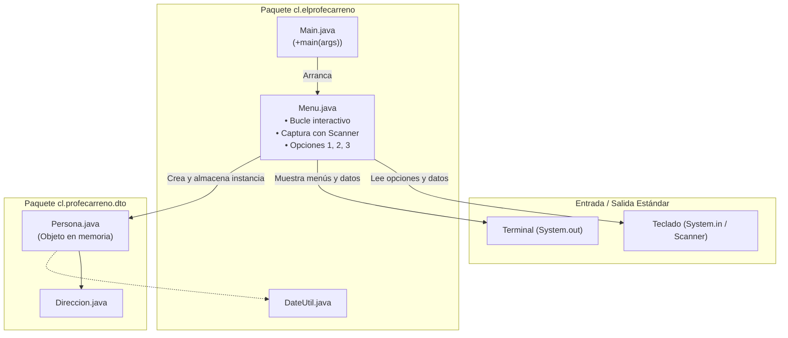
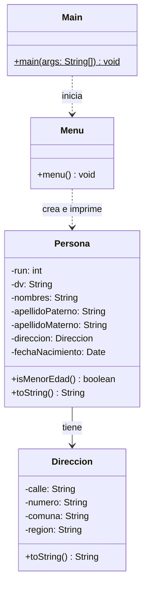
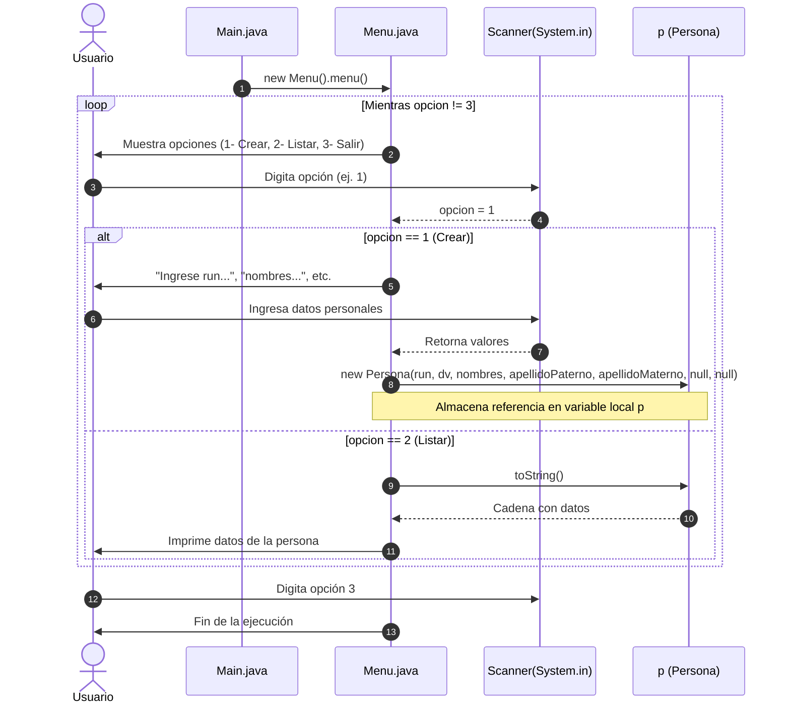

# Proyecto 07 - poo-fundaments (Interacción por Consola y Reorganización en DTO)

Este proyecto introduce la interactividad dinámica con el usuario mediante un menú estructurado por consola y la reorganización de las clases de modelo hacia el paquete **DTO (Data Transfer Object)**. Constituye el **Hito 07** de la serie incremental.

El objetivo pedagógico es abandonar los scripts de ejecución estáticos con datos fijos en `Main.java` y dar paso a aplicaciones conducidas por eventos de usuario (*User-Driven Applications*), gestionando ciclos de vida mediante bucles `while`, estructuras de selección `switch-case` y lectura de teclado mediante `java.util.Scanner`.

*Video de apoyo:* [Abtracción y Encapsulamiento (POO) - Parte 6 Menú](https://youtu.be/xM57KC2hP00)

---

## ¿Qué hace el proyecto?

1. Reorganiza la arquitectura de paquetes del proyecto: las entidades de dominio `Persona` y `Direccion` se trasladan al paquete especializado `cl.profecarreno.dto`, separando el transporte de datos de la lógica de aplicación.
2. Crea la clase controladora de consola `cl.elprofecarreno.Menu`, la cual mantiene un bucle interactivo que presenta tres opciones:
   - **`1- Crear Persona.`**: Solicita interactivamente por consola el RUN, dígito verificador, nombres y apellidos, instanciando el objeto `Persona` en memoria.
   - **`2- Listar Persona.`**: Verifica si la persona existe en memoria y muestra sus datos formateados en consola.
   - **`3- Salir.`**: Termina la ejecución del ciclo y del programa.
3. Simplifica `Main.java`, convirtiéndolo en un punto de arranque limpio que únicamente delega el control en `new Menu().menu()`.

---

## Diferencias Clave: Proyecto 07 vs. Proyecto 06

| Componente / Concepto | Proyecto 06 | Proyecto 07 | Beneficio / Justificación |
| :--- | :--- | :--- | :--- |
| **Arquitectura de Paquetes** | Todas las clases de modelo compartían el paquete `cl.elprofecarreno`. | Separa el modelo en `cl.profecarreno.dto` y el flujo en `cl.elprofecarreno`. | Alta cohesión: desacopla los objetos de datos (*DTO*) de las clases que manejan el flujo de la aplicación. |
| **Control de Flujo** | Ejecución lineal estática (un solo paso y finaliza). | Bucle continuo interactivo (`while (opcion != 3)`) con `switch-case`. | Permite al usuario interactuar repetidamente con el sistema sin reiniciar el programa. |
| **Captura de Entrada** | Datos predefinidos en código fuente (*hardcoded*). | Captura dinámica de datos por teclado mediante `java.util.Scanner`. | Convierte el proyecto en un software interactivo real dependiente de la interacción humana. |
| **Responsabilidad de `Main`** | Contenía la lógica de prueba, instanciación e impresión. | Actúa únicamente como arrancador (*bootstrap*); delega en `Menu`. | Cumple con el Principio de Responsabilidad Única (SRP). |

---

## Diagrama de Componentes



---

## Diagrama de Clases



---

## Diagrama de Flujo e Interacción



---

## Paso a Paso para la Construcción Incremental (desde Proyecto 06)

### Paso 1: Mover `Persona` y `Direccion` al paquete DTO
Crea el paquete `cl.profecarreno.dto` y ubica en él las clases `Direccion.java` y `Persona.java`:

```java
package cl.profecarreno.dto;

import cl.elprofecarreno.util.DateUtil;
import java.util.Date;
import lombok.AllArgsConstructor;
import lombok.Getter;
import lombok.NoArgsConstructor;
import lombok.Setter;

@Getter
@Setter
@AllArgsConstructor
@NoArgsConstructor
public class Persona {

    private int run;
    private String dv;
    private String nombres;
    private String apellidoPaterno;
    private String apellidoMaterno;
    private Direccion direccion;
    private Date fechaNacimiento;

    public boolean isMenorEdad() {
        return DateUtil.calcularEdad(this.fechaNacimiento, new Date()) < 18;
    }

    @Override
    public String toString() {
        return "Persona{" + "run=" + run + ", dv=" + dv + ", nombres=" + nombres 
                + ", apellidoPaterno=" + apellidoPaterno + ", apellidoMaterno=" + apellidoMaterno 
                + ", direccion=" + direccion + ", fechaNacimiento=" + fechaNacimiento + '}';
    }
}
```

### Paso 2: Crear la clase `Menu.java`
En `src/main/java/cl/elprofecarreno/Menu.java`, implementa el ciclo y la captura interactiva:

```java
package cl.elprofecarreno;

import cl.profecarreno.dto.Persona;
import java.util.Scanner;

public class Menu {

    public void menu() {
        int opcion = 0;
        Persona p = null;
        Scanner sc = new Scanner(System.in);

        while (opcion != 3) {
            System.out.println("\t\t\t MENÚ");
            System.out.println("\n\n1- Crear Persona.");
            System.out.println("\n2- Listar Persona.");
            System.out.println("\n3- Salir.");
            System.out.print("Seleccione una opción: ");
            opcion = sc.nextInt();

            switch (opcion) {
                case 1:
                    System.out.println("CREANDO PERSONA.");
                    System.out.print("Ingrese run sin dígito verificador: ");
                    int run = sc.nextInt();
                    System.out.print("Ingrese dígito verificador: ");
                    String dv = sc.next();
                    System.out.print("Ingrese nombres: ");
                    String nombres = sc.next();
                    System.out.print("Apellido paterno: ");
                    String apellidoPaterno = sc.next();
                    System.out.print("Apellido materno: ");
                    String apellidoMaterno = sc.next();

                    p = new Persona(run, dv, nombres, apellidoPaterno, apellidoMaterno, null, null);
                    break;
                case 2:
                    System.out.println("Mostrando Datos de la Persona.");
                    if (p != null) {
                        System.out.println(p.toString());
                    } else {
                        System.out.println("No hay ninguna persona registrada.");
                    }
                    break;
                case 3:
                    System.out.println("Saliendo del sistema...");
                    break;
                default:
                    System.out.println("Opción no válida.");
            }
        }
    }
}
```

### Paso 3: Simplificar `Main.java`
En `src/main/java/cl/elprofecarreno/Main.java`:

```java
package cl.elprofecarreno;

public class Main {

    public static void main(String[] args) {
        Menu menu = new Menu();
        menu.menu();
    }
}
```

---

## Estructura del Proyecto

```text
07/
├── README.md
└── abstraccion-encapsulamiento/
    ├── pom.xml
    └── src/
        └── main/
            └── java/
                ├── cl/
                │   ├── elprofecarreno/
                │   │   ├── Main.java
                │   │   ├── Menu.java
                │   │   └── util/
                │   │       └── DateUtil.java
                │   └── profecarreno/
                │       └── dto/
                │           ├── Direccion.java
                │           └── Persona.java
```

---

## Requisitos y Ejecución

### Requisitos
- **Java JDK**: 21 (o superior).
- **Apache Maven**: 3.8 (o superior).

### Ejecución
```bash
cd 07/abstraccion-encapsulamiento
mvn clean compile exec:java
```

O desde la raíz de `poo-fundaments`:
```bash
mvn -f 07/abstraccion-encapsulamiento/pom.xml clean compile exec:java
```

### Simulación de sesión en consola
```text
			 MENÚ


1- Crear Persona.

2- Listar Persona.

3- Salir.
Seleccione una opción: 1
CREANDO PERSONA.
Ingrese run sin dígito verificador: 18765432
Ingrese dígito verificador: K
Ingrese nombres: Carlos
Apellido paterno: Carreño
Apellido materno: Aliaga

			 MENÚ


1- Crear Persona.

2- Listar Persona.

3- Salir.
Seleccione una opción: 2
Mostrando Datos de la Persona.
Persona{run=18765432, dv=K, nombres=Carlos, apellidoPaterno=Carreño, apellidoMaterno=Aliaga, direccion=null, fechaNacimiento=null}
```

---

## Objetivos Pedagógicos y Buenas Prácticas

- **Bucle de Control Principal**: Comprender el patrón de ejecución interactivo mediante bucles condicionales controlados por centinela.
- **DTO (Data Transfer Object)**: Entender la conveniencia de agrupar los datos en clases de transporte desacopladas de la lógica de interfaz.
- **Mantenimiento del Estado en Memoria**: Entender que mientras dure el ciclo de la aplicación, las referencias viven en la memoria heap, pero se pierden al finalizar si no se cuenta con persistencia externa.
