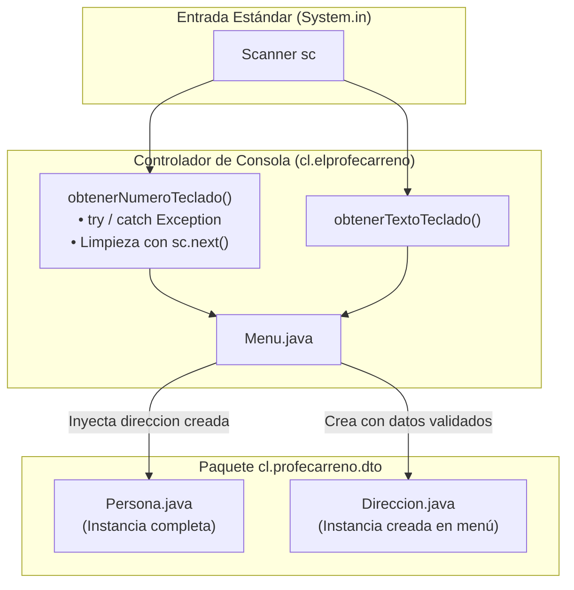
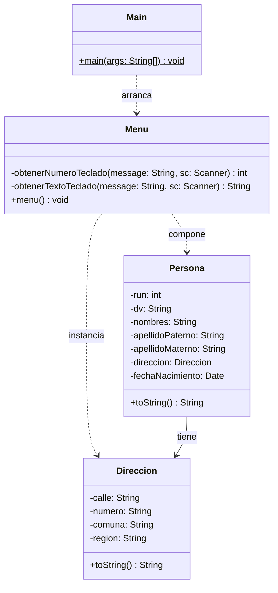
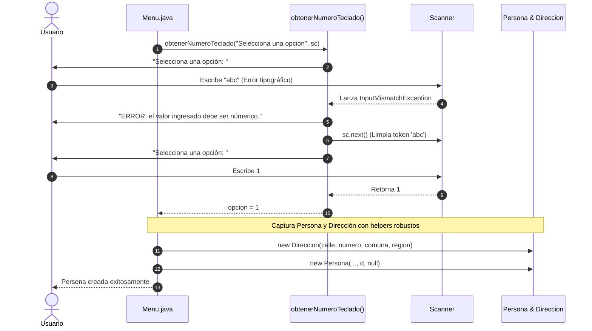

# Proyecto 08 - poo-fundaments (Entrada Robusta, Captura Defensiva y Composición en Menú)

Este proyecto introduce técnicas avanzadas de **Programación Defensiva** en la interfaz de consola, resolviendo las vulnerabilidades comunes de lectura de teclado (`InputMismatchException`) e integrando la captura completa e interactiva de objetos asociados (`Direccion`). Constituye el **Hito 08** de la serie incremental.

El objetivo pedagógico es aprender a construir interfaces de consola tolerantes a fallos del usuario, implementando rutinas de validación en bucle con bloques de control de excepciones `try-catch`, y ensamblando en tiempo de ejecución grafos de objetos completos (`Persona` compuesta por `Direccion`).

*Video de apoyo:* [Abtracción y Encapsulamiento (POO) - Parte 7 Menú.](https://youtu.be/a44sjVPWv0I)

---

## ¿Qué hace el proyecto?

1. Detecta y mitiga la fragilidad de `Scanner.nextInt()`: si un usuario ingresaba letras cuando el programa solicitaba un número, la aplicación en el Hito 07 se caía de inmediato por una excepción no controlada.
2. Implementa en `Menu.java` métodos auxiliares privados:
   - **`obtenerNumeroTeclado(String message, Scanner sc)`**: Envuelve la lectura en un bucle `while` con `try-catch`. Si el usuario ingresa un dato no numérico, captura la excepción, emite un mensaje de error claro, limpia el búfer con `sc.next()` y reintenta la lectura hasta obtener un entero válido.
   - **`obtenerTextoTeclado(String message, Scanner sc)`**: Estandariza la petición y lectura de cadenas de texto por consola.
3. Extiende el flujo de creación de persona: tras capturar los datos personales, solicita interactivamente los 4 campos del domicilio (`calle`, `número`, `comuna` y `región`), instancia un objeto `Direccion` y lo asocia directamente a la instancia de `Persona`.
4. Al listar la persona (opción 2), se comprueba que el objeto `Direccion` ya no es `null`, mostrando el domicilio completo asociado.

---

## Diferencias Clave: Proyecto 08 vs. Proyecto 07

| Componente / Concepto | Proyecto 07 | Proyecto 08 | Beneficio / Justificación |
| :--- | :--- | :--- | :--- |
| **Tolerancia a Fallos en Entrada** | `sc.nextInt()` directo; si el usuario ingresaba texto, la JVM abortaba con `InputMismatchException`. | Método `obtenerNumeroTeclado` con bucle defensivo y captura de excepciones. | **Programación Defensiva**: la aplicación nunca colapsa ante errores de tipeo del operador. |
| **Limpieza del Búfer** | No se gestionaba el búfer de entrada. | Invoca `sc.next()` en el bloque `catch` para vaciar el token erróneo del canal. | Previene bucles infinitos en consola generados por tokens no consumidos. |
| **Captura de Dirección** | Se pasaba `null` en el constructor de `Persona` (`direccion = null`). | Se solicitan interactivamente `calle`, `numero`, `comuna` y `region`, instanciando `Direccion`. | Completa la composición del objeto en tiempo de ejecución según las decisiones del usuario. |
| **Reutilización de Código** | Mensajes de petición e invocaciones a `Scanner` repetidas sin método auxiliar. | Métodos modulares de extracción por teclado reutilizados en todo el menú. | Código más limpio, cohesivo y mantenible (Principio DRY). |

---

## Diagrama de Componentes



---

## Diagrama de Clases



---

## Diagrama de Flujo e Interacción



---

## Paso a Paso para la Construcción Incremental (desde Proyecto 07)

### Paso 1: Implementar métodos de entrada defensiva en `Menu.java`
Edita `src/main/java/cl/elprofecarreno/Menu.java` e incorpora las funciones de lectura con control de excepciones:

```java
package cl.elprofecarreno;

import cl.profecarreno.dto.Direccion;
import cl.profecarreno.dto.Persona;
import java.util.Scanner;

public class Menu {

    private int obtenerNumeroTeclado(String message, Scanner sc) {
        boolean flag = true;
        int value = 0;
        while (flag) {
            try {
                System.out.print(message + ": ");
                value = sc.nextInt();
                flag = false;
            } catch (Exception ex) {
                System.out.println("ERROR: el valor ingresado debe ser númerico.");
                sc.next(); // Limpia el búfer consumiendo el token no numérico
            }
        }
        return value;
    }

    private String obtenerTextoTeclado(String message, Scanner sc) {
        System.out.print(message + ": ");
        return sc.next();
    }
```

### Paso 2: Integrar la creación interactiva de `Direccion`
En el mismo archivo `Menu.java`, actualiza el método `menu()`:

```java
    public void menu() {
        int opcion = 0;
        Persona p = null;
        Scanner sc = new Scanner(System.in);

        while (opcion != 3) {
            System.out.println("\t\t\t MENÚ");
            System.out.println("\n\n1- Crear Persona.");
            System.out.println("\n2- Listar Persona.");
            System.out.println("\n3- Salir.");

            opcion = obtenerNumeroTeclado("Selecciona una opción", sc);

            switch (opcion) {
                case 1:
                    System.out.println("CREANDO PERSONA.");
                    int run = obtenerNumeroTeclado("Ingrese run sin dígito verificador", sc);
                    String dv = obtenerTextoTeclado("Ingrese dígito verificador", sc);
                    String nombres = obtenerTextoTeclado("Ingrese nombres", sc);
                    String apellidoPaterno = obtenerTextoTeclado("Apellido paterno", sc);
                    String apellidoMaterno = obtenerTextoTeclado("Apellido materno", sc);

                    System.out.println("CREANDO DIRECCIÓN.");
                    String calle = obtenerTextoTeclado("calle", sc);
                    String numero = obtenerTextoTeclado("número", sc);
                    String comuna = obtenerTextoTeclado("comuna", sc);
                    String region = obtenerTextoTeclado("región", sc);

                    Direccion d = new Direccion(calle, numero, comuna, region);
                    p = new Persona(run, dv, nombres, apellidoPaterno, apellidoMaterno, d, null);
                    break;
                case 2:
                    System.out.println("Mostrando Datos de la Persona.");
                    if (p != null) {
                        System.out.println(p.toString());
                    } else {
                        System.out.println("No se ha registrado ninguna persona.");
                    }
                    break;
                case 3:
                    System.out.println("Saliendo del programa...");
                    break;
                default:
                    System.out.println("Opción no válida.");
            }
        }
    }
}
```

---

## Estructura del Proyecto

```text
08/
├── README.md
└── abstraccion-encapsulamiento/
    ├── pom.xml
    └── src/
        └── main/
            └── java/
                ├── cl/
                │   ├── elprofecarreno/
                │   │   ├── Main.java
                │   │   ├── Menu.java
                │   │   └── util/
                │   │       └── DateUtil.java
                │   └── profecarreno/
                │       └── dto/
                │           ├── Direccion.java
                │           └── Persona.java
```

---

## Requisitos y Ejecución

### Requisitos
- **Java JDK**: 21 (o superior).
- **Apache Maven**: 3.8 (o superior).

### Ejecución
```bash
cd 08/abstraccion-encapsulamiento
mvn clean compile exec:java
```

O desde la raíz de `poo-fundaments`:
```bash
mvn -f 08/abstraccion-encapsulamiento/pom.xml clean compile exec:java
```

### Simulación de sesión con manejo de errores
```text
			 MENÚ


1- Crear Persona.

2- Listar Persona.

3- Salir.
Selecciona una opción: uno
ERROR: el valor ingresado debe ser númerico.
Selecciona una opción: 1
CREANDO PERSONA.
Ingrese run sin dígito verificador: doce-millones
ERROR: el valor ingresado debe ser númerico.
Ingrese run sin dígito verificador: 12345678
Ingrese dígito verificador: 5
Ingrese nombres: Andrea
Apellido paterno: Silva
Apellido materno: Castro
CREANDO DIRECCIÓN.
calle: Agustinas
número: 650
comuna: Santiago
región: RM

			 MENÚ


1- Crear Persona.

2- Listar Persona.

3- Salir.
Selecciona una opción: 2
Mostrando Datos de la Persona.
Persona{run=12345678, dv=5, nombres=Andrea, apellidoPaterno=Silva, apellidoMaterno=Castro, direccion=Direccion(calle=Agustinas, numero=650, comuna=Santiago, region=RM), fechaNacimiento=null}
```

---

## Objetivos Pedagógicos y Buenas Prácticas

- **Programación Defensiva**: Asumir que el usuario puede cometer errores y diseñar barreras de contención para preservar la estabilidad de la aplicación.
- **Manejo de Excepciones**: Comprender el flujo de control no lineal generado por `try-catch` y el descarte de datos viciados con `Scanner.next()`.
- **Composición Completa**: Garantizar que los objetos de dominio complejos reciban todas sus dependencias estructuradas antes de persistir su referencia.
