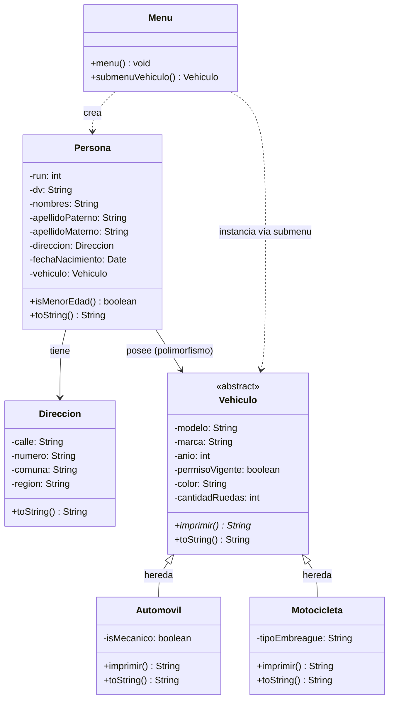
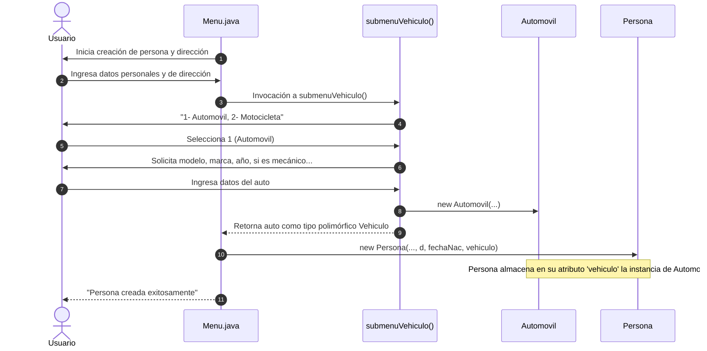

# Proyecto 09 - poo-fundaments (Herencia y Polimorfismo: Jerarquía de Vehículos)

Este proyecto introduce los dos pilares avanzados restantes de la Programación Orientada a Objetos: **Herencia** y **Polimorfismo**. Constituye el **Hito 09** de la serie incremental.

El objetivo pedagógico es modelar jerarquías taxonómicas de clases utilizando clases abstractas (`Vehiculo`), reutilizar atributos y métodos comunes mediante herencia en subclases especializadas (`Automovil` y `Motocicleta`), aplicar polimorfismo dinámico en métodos sobrescritos (`imprimir()`), y construir un submenú interactivo en consola cuyo tipo de retorno sea la abstracción base.

*Video de apoyo:* [Herencia y Polimorfismo (POO) - Parte 8 Menú.](https://youtu.be/tH4_teMTTO0)

---

## ¿Qué hace el proyecto?

1. Modela una jerarquía de transporte en el paquete `cl.profecarreno.dto`:
   - **`Vehiculo` (Clase Abstracta)**: Centraliza los atributos comunes a cualquier medio de transporte terrestre (`modelo`, `marca`, `anio`, `permisoVigente`, `color`, `cantidadRuedas`) y declara el método abstracto `public abstract String imprimir()`.
   - **`Automovil` (Subclase Concreta)**: Hereda de `Vehiculo` y añade la característica propia `isMecanico` (booleano que indica si la transmisión es manual o automática). Sobrescribe `imprimir()` y `toString()`.
   - **`Motocicleta` (Subclase Concreta)**: Hereda de `Vehiculo` y añade la característica propia `tipoEmbreague`. Sobrescribe `imprimir()` y `toString()`.
2. Actualiza `Persona.java` incorporando la relación de asociación: `private Vehiculo vehiculo`.
3. Enriquece `Menu.java` con nuevos métodos utilitarios de entrada (`obtenerBooleanTeclado`, `obtenerTextoLineaTeclado`, `obtenerDateTeclado`).
4. Implementa el método **`submenuVehiculo(): Vehiculo`**:
   - Despliega un menú secundario para elegir entre Automóvil o Motocicleta.
   - Captura las propiedades específicas y comunes.
   - Retorna una referencia de tipo polimórfico `Vehiculo` que contiene en memoria la instancia real (`Automovil` o `Motocicleta`).
5. Al listar la persona, la JVM resuelve dinámicamente en tiempo de ejecución (*Dynamic Dispatch*) la versión de `toString()` e `imprimir()` correspondiente al vehículo concreto asignado.

---

## Diferencias Clave: Proyecto 09 vs. Proyecto 08

| Componente / Concepto | Proyecto 08 | Proyecto 09 | Beneficio / Justificación |
| :--- | :--- | :--- | :--- |
| **Jerarquía de Clases** | Sin herencia de dominio (solo clases planas colaboradoras). | Introduce clase abstracta `Vehiculo` y subclases `Automovil` y `Motocicleta`. | **Herencia**: evita duplicar atributos comunes de transporte en múltiples clases independientes. |
| **Clase Abstracta** | Inexistente. | `public abstract class Vehiculo` con método abstracto `imprimir()`. | Define un contrato obligatorio que todas las subclases de transporte deben implementar. |
| **Polimorfismo en Dominio** | `Persona` solo contenía `Direccion`. | `Persona` tiene una referencia a la clase abstracta `Vehiculo vehiculo`. | Desacoplamiento: la persona puede poseer un automóvil, una motocicleta o cualquier futuro vehículo sin alterar el código de `Persona`. |
| **Submenú y Polimorfismo de Retorno** | Menú plano de 3 opciones fijas. | Introduce `submenuVehiculo()` que retorna `Vehiculo`. | Aplica polimorfismo en la firma de métodos: el llamador recibe la abstracción general sin importar el tipo concreto instanciado. |
| **Helpers de Teclado** | Solo enteros y cadenas de una palabra. | Agrega `obtenerBooleanTeclado` (valida 's'/'n'), `obtenerDateTeclado` y líneas completas. | Mayor versatilidad para capturar opciones lógicas y tipos complejos. |

---

## Diagrama de Componentes

```mermaid
flowchart TB
    subgraph UI_Console["Capa de Consola"]
        MenuClass["Menu.java\n• menu()\n• submenuVehiculo(): Vehiculo"]
        Helpers["Helpers de Teclado\n(boolean, int, text, date)"]
    end

    subgraph Jerarquia_Vehiculos["Jerarquía Polimórfica (cl.profecarreno.dto)"]
        VehiculoClass["Vehiculo.java\n<<abstract>>\n• modelo, marca, anio...\n• +imprimir()*"]
        AutoClass["Automovil.java\n• isMecanico: boolean\n• +imprimir()"]
        MotoClass["Motocicleta.java\n• tipoEmbreague: String\n• +imprimir()"]
    end

    subgraph Entidades_Dominio["Entidades de Dominio (cl.profecarreno.dto)"]
        PersonaClass["Persona.java\n• vehiculo: Vehiculo"]
        DireccionClass["Direccion.java"]
    end

    MenuClass --> Helpers
    AutoClass --|>|extiende| VehiculoClass
    MotoClass --|>|extiende| VehiculoClass
    MenuClass -->|Instancia dinámicamente| AutoClass
    MenuClass -->|Instancia dinámicamente| MotoClass
    PersonaClass -->|Asociación polimórfica| VehiculoClass
    PersonaClass --> DireccionClass
    MenuClass --> PersonaClass
```

---

## Diagrama de Clases



---

## Diagrama de Flujo e Interacción



---

## Paso a Paso para la Construcción Incremental (desde Proyecto 08)

### Paso 1: Crear la clase abstracta `Vehiculo.java`
En `src/main/java/cl/profecarreno/dto/Vehiculo.java`:

```java
package cl.profecarreno.dto;

import lombok.AllArgsConstructor;
import lombok.Getter;
import lombok.NoArgsConstructor;
import lombok.Setter;

@AllArgsConstructor
@NoArgsConstructor
@Getter
@Setter
public abstract class Vehiculo {

    private String modelo;
    private String marca;
    private int anio;
    private boolean permisoVigente;
    private String color;
    private int cantidadRuedas;

    public abstract String imprimir();

    @Override
    public String toString() {
        return "Vehiculo{" + "modelo=" + modelo + ", marca=" + marca + ", anio=" + anio 
                + ", permisoVigente=" + permisoVigente + ", color=" + color 
                + ", cantidadRuedas=" + cantidadRuedas + '}';
    }
}
```

### Paso 2: Crear las subclases `Automovil` y `Motocicleta`
1. `src/main/java/cl/profecarreno/dto/Automovil.java`:
```java
package cl.profecarreno.dto;

import lombok.AllArgsConstructor;
import lombok.Getter;
import lombok.NoArgsConstructor;
import lombok.Setter;

@AllArgsConstructor
@NoArgsConstructor
@Getter
@Setter
public class Automovil extends Vehiculo {

    private boolean isMecanico;

    @Override
    public String imprimir() {
        return "Automóvil " + getMarca() + " " + getModelo() + " (" + (isMecanico ? "Mecánico" : "Automático") + ")";
    }

    @Override
    public String toString() {
        return super.toString() + " Automovil{" + "isMecanico=" + isMecanico + '}';
    }
}
```

2. `src/main/java/cl/profecarreno/dto/Motocicleta.java`:
```java
package cl.profecarreno.dto;

import lombok.AllArgsConstructor;
import lombok.Getter;
import lombok.NoArgsConstructor;
import lombok.Setter;

@NoArgsConstructor
@AllArgsConstructor
@Getter
@Setter
public class Motocicleta extends Vehiculo {

    private String tipoEmbreague;

    @Override
    public String imprimir() {
        return "Motocicleta " + getMarca() + " " + getModelo() + " [Embrague: " + tipoEmbreague + "]";
    }

    @Override
    public String toString() {
        return super.toString() + " Motocicleta{" + "tipoEmbreague=" + tipoEmbreague + '}';
    }
}
```

### Paso 3: Asociar `Vehiculo` en `Persona.java`
Agrega el campo `private Vehiculo vehiculo` y actualiza el constructor y `toString()` en `cl.profecarreno.dto.Persona`:

```java
    private Direccion direccion;
    private Date fechaNacimiento;
    private Vehiculo vehiculo;
```

### Paso 4: Implementar `submenuVehiculo()` en `Menu.java`
Incorpora el selector polimórfico en `src/main/java/cl/elprofecarreno/Menu.java`:

```java
    public Vehiculo submenuVehiculo() {
        int opcion = 0;
        boolean flag = true;
        Vehiculo v = null;

        while (flag) {
            System.out.println("\t\t\t SELECCIONAR TIPO VEHÍCULO");
            System.out.println("\n\n1- Automovil.");
            System.out.println("\n2- Motocicleta.");
            opcion = obtenerNumeroTeclado("Ingrese una opción");
            switch (opcion) {
                case 1:
                    boolean isMecanico = obtenerBooleanTeclado("Es mecánico (s/n)");
                    Automovil auto = new Automovil(isMecanico);
                    auto.setMarca(obtenerTextoTeclado("Ingresar Marca"));
                    auto.setModelo(obtenerTextoTeclado("Ingresar Modelo"));
                    auto.setAnio(obtenerNumeroTeclado("Ingresar Año Fabricación"));
                    auto.setColor(obtenerTextoTeclado("Ingresar Color"));
                    auto.setCantidadRuedas(4);
                    auto.setPermisoVigente(obtenerBooleanTeclado("¿Permiso de circulación al día? (s/n)"));
                    v = auto;
                    flag = false;
                    break;
                case 2:
                    String tipoEmbreague = obtenerTextoTeclado("Ingresar Tipo Embrague");
                    Motocicleta moto = new Motocicleta(tipoEmbreague);
                    moto.setMarca(obtenerTextoTeclado("Ingresar Marca"));
                    moto.setModelo(obtenerTextoTeclado("Ingresar Modelo"));
                    moto.setAnio(obtenerNumeroTeclado("Ingresar Año Fabricación"));
                    moto.setColor(obtenerTextoTeclado("Ingresar Color"));
                    moto.setCantidadRuedas(2);
                    moto.setPermisoVigente(obtenerBooleanTeclado("¿Permiso de circulación al día? (s/n)"));
                    v = moto;
                    flag = false;
                    break;
                default:
                    System.out.println("Opción no válida.");
            }
        }
        return v;
    }
```

---

## Estructura del Proyecto

```text
09/
├── README.md
└── abstraccion-encapsulamiento/
    ├── pom.xml
    └── src/
        └── main/
            └── java/
                ├── cl/
                │   ├── elprofecarreno/
                │   │   ├── Main.java
                │   │   ├── Menu.java
                │   │   └── util/
                │   │       └── DateUtil.java
                │   └── profecarreno/
                │       └── dto/
                │           ├── Automovil.java
                │           ├── Direccion.java
                │           ├── Motocicleta.java
                │           ├── Persona.java
                │           └── Vehiculo.java
```

---

## Requisitos y Ejecución

### Requisitos
- **Java JDK**: 21 (o superior).
- **Apache Maven**: 3.8 (o superior).

### Ejecución
```bash
cd 09/abstraccion-encapsulamiento
mvn clean compile exec:java
```

O desde la raíz de `poo-fundaments`:
```bash
mvn -f 09/abstraccion-encapsulamiento/pom.xml clean compile exec:java
```

### Simulación de sesión con submenú polimórfico
```text
CREANDO PERSONA.
Ingrese run sin dígito verificador: 17890123
Ingrese dígito verificador: 4
Ingrese nombres: Rodrigo
Apellido paterno: Morales
Apellido materno: Rojas

CREANDO DIRECCIÓN.
calle: Las Palmeras
número: 890
comuna: La Serena
región: Coquimbo

			 SELECCIONAR TIPO VEHÍCULO

1- Automovil.
2- Motocicleta.
Ingrese una opción: 1
Es mecánico (s/n): s
Ingresar Marca: Toyota
Ingresar Modelo: Yaris
Ingresar Año Fabricación: 2021
Ingresar Color: Gris
¿Permiso de circulación al día? (s/n): s

			 MENÚ

1- Crear Persona.
2- Listar Persona.
3- Salir.
Selecciona una opción: 2
Mostrando Datos de la Persona.
Persona{run=17890123, dv=4, nombres=Rodrigo, apellidoPaterno=Morales, apellidoMaterno=Rojas, direccion=Direccion(calle=Las Palmeras, numero=890, comuna=La Serena, region=Coquimbo), vehiculo=Vehiculo{modelo=Yaris, marca=Toyota, anio=2021, permisoVigente=true, color=Gris, cantidadRuedas=4} Automovil{isMecanico=true}}
```

---

## Objetivos Pedagógicos y Buenas Prácticas

- **Reutilización de Código vía Herencia**: Centralizar campos y métodos comunes en la clase padre para reducir duplicación.
- **Clases y Métodos Abstractos**: Forzar a las subclases a proveer implementaciones específicas del método `imprimir()`.
- **Principio de Sustitución de Liskov (LSP)**: Una instancia de `Automovil` o `Motocicleta` puede sustituir a `Vehiculo` en cualquier punto del sistema sin romper la lógica del programa.
- **Despacho Dinámico de Métodos**: Comprender que en tiempo de ejecución la JVM invoca el método correspondiente al tipo real del objeto instanciado en el Heap, no al tipo de la variable de referencia.
