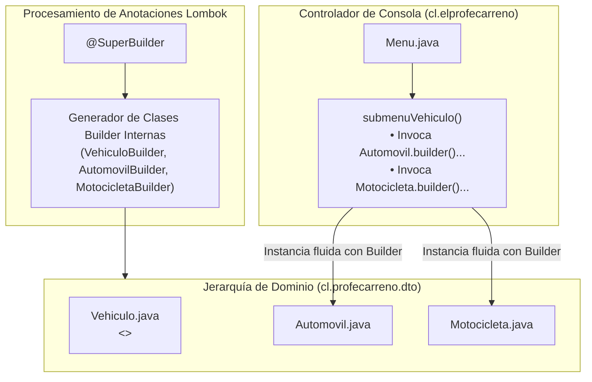
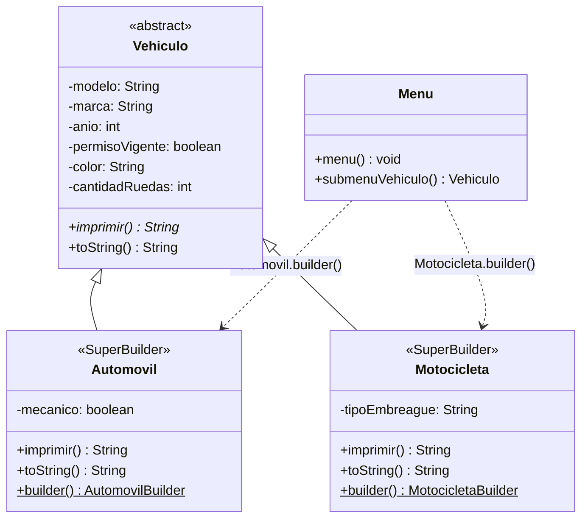
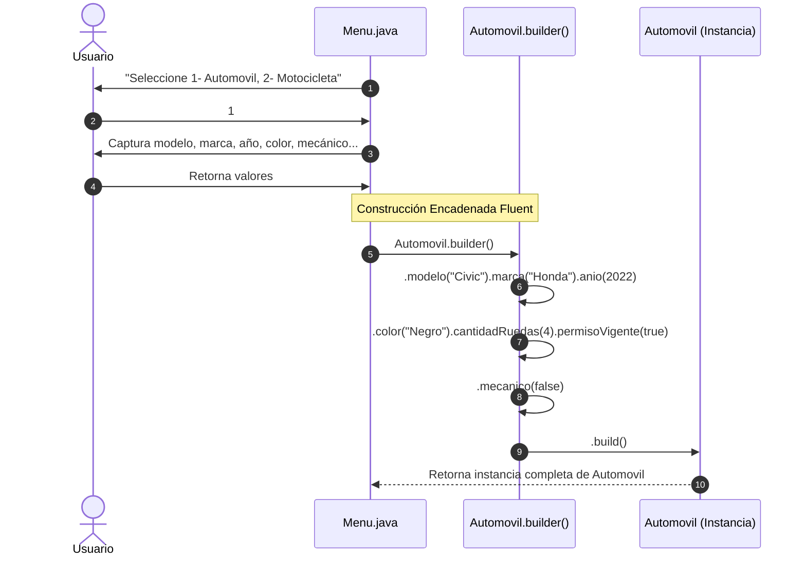

# Proyecto 10 - poo-fundaments (Patrón Creacional Builder con Lombok @SuperBuilder)

Este proyecto introduce el patrón de diseño creacional **Builder** adaptado a jerarquías de herencia mediante la anotación avanzada de Lombok **`@SuperBuilder`**. Constituye el **Hito 10** de la serie incremental.

El objetivo pedagógico principal es aprender a resolver un problema clásico de la Programación Orientada a Objetos: cómo instanciar objetos complejos con múltiples atributos heredados de una clase padre sin recurrir a constructores monstruosos (*Telescoping Constructors*) ni a llamadas dispersas a métodos *setters* que dejen al objeto en un estado inconsistente temporal.

*Video de apoyo:* [Herencia y Polimorfismo (POO) - Parte 9 Menú](https://youtu.be/3XMs3QYabzc)

---

## ¿Qué hace el proyecto?

1. Decora la clase abstracta `Vehiculo` y sus subclases `Automovil` y `Motocicleta` con la anotación **`@SuperBuilder`** de `lombok.experimental.SuperBuilder`.
2. Estandariza el atributo en `Automovil`: pasa de `isMecanico` a `mecanico`, manteniendo la coherencia con los procesadores de Lombok.
3. Refactoriza integralmente el método `submenuVehiculo()` en `Menu.java`:
   - Centraliza la captura previa de todos los datos comunes de transporte (`modelo`, `marca`, `año`, `color`, `permiso de circulación`).
   - Reemplaza la instanciación por setters por llamadas fluidas con el patrón Builder:
     - `Automovil.builder().modelo(m).marca(mar).anio(a)...mecanico(mec).build()`
     - `Motocicleta.builder().modelo(m).marca(mar).anio(a)...tipoEmbreague(emb).build()`
4. El objeto resultante se ensambla de forma atómica, inmutable y segura, transmitiendo todas las propiedades heredadas directamente desde la construcción.

---

## Diferencias Clave: Proyecto 10 vs. Proyecto 09

| Componente / Concepto | Proyecto 09 | Proyecto 10 | Beneficio / Justificación |
| :--- | :--- | :--- | :--- |
| **Patrón Creacional** | Constructores convencionales combinados con múltiples llamadas a *setters*. | **Patrón Builder con `@SuperBuilder`**. | Permite la construcción fluida (*Fluent API*) y asegura que el objeto nazca completamente inicializado. |
| **Soporte de Herencia en Builder** | El `@Builder` tradicional de Lombok no hereda campos de la clase padre. | `@SuperBuilder` genera constructores fluidos jerárquicos bidireccionales. | La subclase (`Automovil`) expone los métodos `.modelo()`, `.marca()`, etc., definidos originalmente en `Vehiculo`. |
| **Seguridad de Estado (Thread-Safety)** | Objetos mutables durante la fase de asignación de setters. | Construcción atómica en un único paso con `.build()`. | Evita que otros hilos o métodos accedan a un vehículo a medio construir. |
| **Legibilidad del Código** | Más de 10 líneas de código secuencial `v.set...()` por cada caso. | Encadenamiento declarativo autodocumentado. | Facilita la lectura y mantenimiento del código en la capa de interacción. |

---

## Diagrama de Componentes



---

## Diagrama de Clases



---

## Diagrama de Flujo e Interacción



---

## Paso a Paso para la Construcción Incremental (desde Proyecto 09)

### Paso 1: Configurar `@SuperBuilder` en `Vehiculo.java`
Edita `src/main/java/cl/profecarreno/dto/Vehiculo.java` importando `lombok.experimental.SuperBuilder`:

```java
package cl.profecarreno.dto;

import lombok.AllArgsConstructor;
import lombok.Getter;
import lombok.NoArgsConstructor;
import lombok.Setter;
import lombok.experimental.SuperBuilder;

@AllArgsConstructor
@NoArgsConstructor
@Getter
@Setter
@SuperBuilder
public abstract class Vehiculo {

    private String modelo;
    private String marca;
    private int anio;
    private boolean permisoVigente;
    private String color;
    private int cantidadRuedas;

    public abstract String imprimir();

    @Override
    public String toString() {
        return "Vehiculo{" + "modelo=" + modelo + ", marca=" + marca + ", anio=" + anio 
                + ", permisoVigente=" + permisoVigente + ", color=" + color 
                + ", cantidadRuedas=" + cantidadRuedas + '}';
    }
}
```

### Paso 2: Configurar `@SuperBuilder` en `Automovil.java` y `Motocicleta.java`
1. En `Automovil.java`:
```java
package cl.profecarreno.dto;

import lombok.AllArgsConstructor;
import lombok.Getter;
import lombok.NoArgsConstructor;
import lombok.Setter;
import lombok.experimental.SuperBuilder;

@AllArgsConstructor
@NoArgsConstructor
@Getter
@Setter
@SuperBuilder
public class Automovil extends Vehiculo {

    private boolean mecanico;

    @Override
    public String imprimir() {
        return "Automóvil " + getMarca() + " " + getModelo() + " (" + (mecanico ? "Mecánico" : "Automático") + ")";
    }

    @Override
    public String toString() {
        return super.toString() + " Automovil{" + "mecanico=" + mecanico + '}';
    }
}
```

2. En `Motocicleta.java`:
```java
package cl.profecarreno.dto;

import lombok.AllArgsConstructor;
import lombok.Getter;
import lombok.NoArgsConstructor;
import lombok.Setter;
import lombok.experimental.SuperBuilder;

@NoArgsConstructor
@AllArgsConstructor
@Getter
@Setter
@SuperBuilder
public class Motocicleta extends Vehiculo {

    private String tipoEmbreague;

    @Override
    public String imprimir() {
        return "Motocicleta " + getMarca() + " " + getModelo() + " [Embrague: " + tipoEmbreague + "]";
    }

    @Override
    public String toString() {
        return super.toString() + " Motocicleta{" + "tipoEmbreague=" + tipoEmbreague + '}';
    }
}
```

### Paso 3: Aplicar el Builder en `Menu.java`
En `src/main/java/cl/elprofecarreno/Menu.java`, refactoriza `submenuVehiculo()`:

```java
    public Vehiculo submenuVehiculo() {
        int opcion = 0;
        boolean flag = true;
        Vehiculo v = null;
        
        while (flag) {
            System.out.println("\t\t\t SELECCIONAR TIPO VEHÍCULO");
            System.out.println("\n\n1- Automovil.");
            System.out.println("\n2- Motocicleta.");
            opcion = obtenerNumeroTeclado("Ingrese una opción");
            
            if (opcion == 1 || opcion == 2) {
                String modelo = obtenerTextoTeclado("Ingresar Modelo");
                String marca = obtenerTextoTeclado("Ingresar Marca");
                int anio = obtenerNumeroTeclado("Ingresar Año Fabricación");
                boolean permisoVigente = obtenerBooleanTeclado("¿Permiso de circulación al día? (s/n)");
                String color = obtenerTextoTeclado("Ingresar Color");
                int cantidadRuedas = (opcion == 1) ? 4 : 2;

                if (opcion == 1) {
                    boolean mecanico = obtenerBooleanTeclado("Es mecánico (s/n)");
                    v = Automovil.builder()
                            .modelo(modelo)
                            .marca(marca)
                            .anio(anio)
                            .permisoVigente(permisoVigente)
                            .color(color)
                            .cantidadRuedas(cantidadRuedas)
                            .mecanico(mecanico)
                            .build();
                } else {
                    String tipoEmbreague = obtenerTextoTeclado("Ingresar Tipo Embrague");
                    v = Motocicleta.builder()
                            .modelo(modelo)
                            .marca(marca)
                            .anio(anio)
                            .permisoVigente(permisoVigente)
                            .color(color)
                            .cantidadRuedas(cantidadRuedas)
                            .tipoEmbreague(tipoEmbreague)
                            .build();
                }
                flag = false;
            } else {
                System.out.println("Opción no válida.");
            }
        }
        return v;
    }
```

---

## Estructura del Proyecto

```text
10/
├── README.md
└── abstraccion-encapsulamiento/
    ├── pom.xml
    └── src/
        └── main/
            └── java/
                ├── cl/
                │   ├── elprofecarreno/
                │   │   ├── Main.java
                │   │   ├── Menu.java
                │   │   └── util/
                │   │       └── DateUtil.java
                │   └── profecarreno/
                │       └── dto/
                │           ├── Automovil.java
                │           ├── Direccion.java
                │           ├── Motocicleta.java
                │           ├── Persona.java
                │           └── Vehiculo.java
```

---

## Requisitos y Ejecución

### Requisitos
- **Java JDK**: 21 (o superior).
- **Apache Maven**: 3.8 (o superior).

### Ejecución
```bash
cd 10/abstraccion-encapsulamiento
mvn clean compile exec:java
```

O desde la raíz de `poo-fundaments`:
```bash
mvn -f 10/abstraccion-encapsulamiento/pom.xml clean compile exec:java
```

### Simulación de sesión con construcción fluida
```text
CREANDO PERSONA.
Ingrese run sin dígito verificador: 19876543
Ingrese dígito verificador: 2
Ingrese nombres: Valentina
Apellido paterno: Araya
Apellido materno: Bravo

CREANDO DIRECCIÓN.
calle: Av. Las Condes
número: 11000
comuna: Las Condes
región: RM

			 SELECCIONAR TIPO VEHÍCULO

1- Automovil.
2- Motocicleta.
Ingrese una opción: 2
Ingresar Modelo: Ninja 400
Ingresar Marca: Kawasaki
Ingresar Año Fabricación: 2023
¿Permiso de circulación al día? (s/n): s
Ingresar Color: Verde
Ingresar Tipo Embrague: Multidisco en baño de aceite

			 MENÚ

1- Crear Persona.
2- Imprimir Datos Persona.
3- Salir.
Selecciona una opción: 2
Mostrando Datos de la Persona.
Persona{run=19876543, dv=2, nombres=Valentina, apellidoPaterno=Araya, apellidoMaterno=Bravo, direccion=Direccion(calle=Av. Las Condes, numero=11000, comuna=Las Condes, region=RM), vehiculo=Vehiculo{modelo=Ninja 400, marca=Kawasaki, anio=2023, permisoVigente=true, color=Verde, cantidadRuedas=2} Motocicleta{tipoEmbreague=Multidisco en baño de aceite}}
```

---

## Objetivos Pedagógicos y Buenas Prácticas

- **Patrón Creacional Builder**: Construir objetos complejos paso a paso evitando constructores con decenas de parámetros.
- **Herencia Resuelta con `@SuperBuilder`**: Aprovechar la extensión de Lombok para que el constructor fluido reconozca todos los niveles jerárquicos de la clase.
- **Inmutabilidad y Coherencia**: Reducir el uso de *setters* después de que el objeto ha sido construido para proteger su consistencia.
