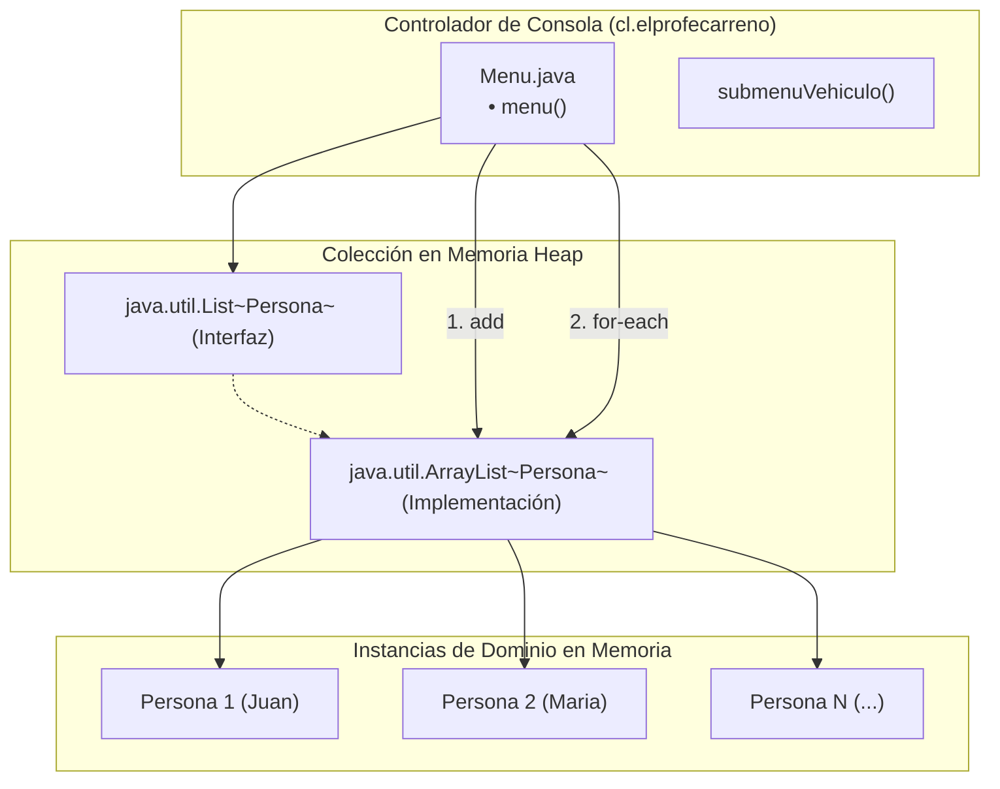
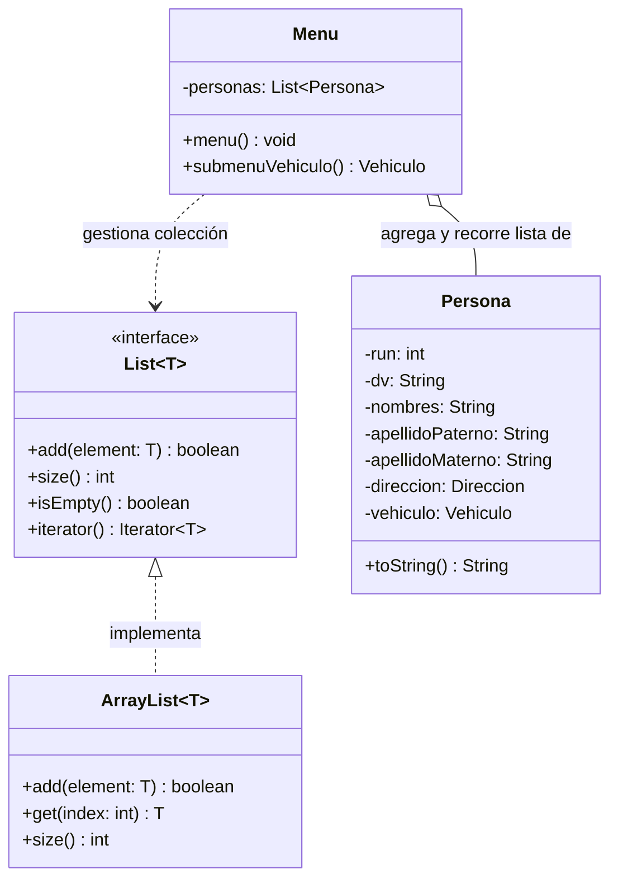
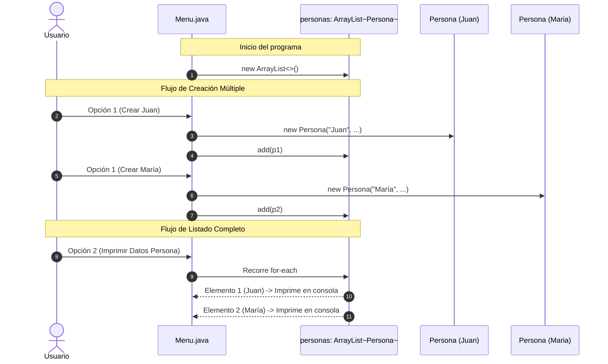

# Proyecto 11 - poo-fundaments (Colecciones Dinámicas en Memoria: List y ArrayList)

Este proyecto marca la transición fundamental desde el almacenamiento de un único registro en memoria hacia la gestión de **colecciones dinámicas de objetos** mediante el Java Collections Framework (`java.util.List` y `java.util.ArrayList`). Constituye el **Hito 11** de la serie incremental.

El objetivo pedagógico es comprender la limitación de las variables de referencia simples (que se sobrescribían con cada nueva creación) y aprender a utilizar estructuras de datos dinámicas, redimensionables y genéricas (`List<Persona>`) para almacenar, acumular y recorrer múltiples instancias de dominio en memoria heap durante la sesión de la aplicación.

*Video de apoyo:* [Herencia y Polimorfismo (POO) - Parte 10 List (ArrayList)](https://youtu.be/63xDgX0D-5U)

---

## ¿Qué hace el proyecto?

1. Sustituye la variable única `Persona p = null` dentro de `Menu.java` por una colección dinámica tipada:
   ```java
   List<Persona> personas = new ArrayList<>();
   ```
2. Modifica la opción **`1- Crear Persona.`**:
   - Captura los datos de identidad, dirección y vehículo (vía `submenuVehiculo()`).
   - Instancia la nueva `Persona`.
   - Agrega la instancia a la colección mediante el método de inserción:
     ```java
     personas.add(p);
     ```
   - Informa al usuario que la persona ha sido almacenada correctamente en la lista.
3. Modifica la opción **`2- Imprimir Datos Persona.`**:
   - Evalúa si la colección contiene registros (`personas.isEmpty()`).
   - Si existen elementos, ejecuta un bucle de recorrido iterativo (*enhanced for loop* / for-each):
     ```java
     for (Persona persona : personas) {
         System.out.println(persona.toString());
     }
     ```
   - Muestra en consola el catálogo completo de personas registradas, cada una con su respectiva dirección y vehículo.

---

## Diferencias Clave: Proyecto 11 vs. Proyecto 10

| Componente / Concepto | Proyecto 10 | Proyecto 11 | Beneficio / Justificación |
| :--- | :--- | :--- | :--- |
| **Almacenamiento de Estado** | Variable escalar única `Persona p`. Cada nuevo registro destruía el anterior. | Colección dinámica `List<Persona> personas = new ArrayList<>()`. | Permite persistir en memoria una cantidad arbitraria de registros durante la sesión del usuario. |
| **Java Collections Framework** | No se utilizaban colecciones. | Integra la interfaz `List` y su implementación basada en arreglos dinámicos `ArrayList`. | Beneficio del polimorfismo de interfaces: programar contra la interfaz `List` en lugar de la clase concreta `ArrayList`. |
| **Operación de Creación** | Asignación directa a variable local. | Inserción en colección (`personas.add(p)`). | Sienta las bases para implementar repositorios y almacenamiento estructurado de entidades. |
| **Operación de Lectura** | Impresión del único objeto en memoria (o advertencia si era null). | Recorrido iterativo de toda la lista mediante for-each. | Capacidad para reportar catálogos completos de datos agregados. |

---

## Diagrama de Componentes



---

## Diagrama de Clases



---

## Diagrama de Flujo e Interacción



---

## Paso a Paso para la Construcción Incremental (desde Proyecto 10)

### Paso 1: Importar `List` y `ArrayList` en `Menu.java`
Edita `src/main/java/cl/elprofecarreno/Menu.java` e importa las clases de colecciones:

```java
import java.util.ArrayList;
import java.util.List;
```

### Paso 2: Inicializar la lista y actualizar el bucle principal
Reemplaza la variable `Persona p = null` por la lista genérica `List<Persona> personas = new ArrayList<>()`:

```java
    public void menu() {
        int opcion = 0;
        List<Persona> personas = new ArrayList<>();
        Scanner sc = new Scanner(System.in);

        while (opcion != 3) {
            System.out.println("\t\t\t MENÚ");
            System.out.println("\n\n1- Crear Persona.");
            System.out.println("\n2- Imprimir Datos Persona.");
            System.out.println("\n3- Salir.");

            opcion = obtenerNumeroTeclado("Selecciona una opción");

            switch (opcion) {
                case 1:
                    System.out.println("CREANDO PERSONA.");
                    int run = obtenerNumeroTeclado("Ingrese run sin dígito verificador");
                    String dv = obtenerTextoTeclado("Ingrese dígito verificador");
                    String nombres = obtenerTextoTeclado("Ingrese nombres");
                    String apellidoPaterno = obtenerTextoTeclado("Apellido paterno");
                    String apellidoMaterno = obtenerTextoTeclado("Apellido materno");

                    System.out.println("CREANDO DIRECCIÓN.");
                    String calle = obtenerTextoTeclado("calle");
                    String numero = obtenerTextoTeclado("número");
                    String comuna = obtenerTextoTeclado("comuna");
                    String region = obtenerTextoTeclado("región");

                    Direccion d = new Direccion(calle, numero, comuna, region);
                    Vehiculo v = submenuVehiculo();

                    Persona p = new Persona(run, dv, nombres, apellidoPaterno, apellidoMaterno, d, null, v);
                    personas.add(p);
                    System.out.println("Persona agregada exitosamente a la lista. Total: " + personas.size());
                    break;

                case 2:
                    System.out.println("Mostrando Datos de todas las Personas registradas:");
                    if (personas.isEmpty()) {
                        System.out.println("No hay personas en el sistema.");
                    } else {
                        for (Persona persona : personas) {
                            System.out.println(persona.toString());
                        }
                    }
                    break;

                case 3:
                    System.out.println("Saliendo del sistema...");
                    break;

                default:
                    System.out.println("Opción no válida.");
            }
        }
    }
```

---

## Estructura del Proyecto

```text
11/
├── README.md
└── abstraccion-encapsulamiento/
    ├── pom.xml
    └── src/
        └── main/
            └── java/
                ├── cl/
                │   ├── elprofecarreno/
                │   │   ├── Main.java
                │   │   ├── Menu.java
                │   │   └── util/
                │   │       └── DateUtil.java
                │   └── profecarreno/
                │       └── dto/
                │           ├── Automovil.java
                │           ├── Direccion.java
                │           ├── Motocicleta.java
                │           ├── Persona.java
                │           └── Vehiculo.java
```

---

## Requisitos y Ejecución

### Requisitos
- **Java JDK**: 21 (o superior).
- **Apache Maven**: 3.8 (o superior).

### Ejecución
```bash
cd 11/abstraccion-encapsulamiento
mvn clean compile exec:java
```

O desde la raíz de `poo-fundaments`:
```bash
mvn -f 11/abstraccion-encapsulamiento/pom.xml clean compile exec:java
```

### Simulación de sesión con múltiples registros
```text
			 MENÚ

1- Crear Persona.
2- Imprimir Datos Persona.
3- Salir.
Selecciona una opción: 1
CREANDO PERSONA.
Ingrese run sin dígito verificador: 11111111
... (Registro de Juan Soto y su Automóvil)
Persona agregada exitosamente a la lista. Total: 1

			 MENÚ

1- Crear Persona.
2- Imprimir Datos Persona.
3- Salir.
Selecciona una opción: 1
CREANDO PERSONA.
Ingrese run sin dígito verificador: 22222222
... (Registro de María López y su Motocicleta)
Persona agregada exitosamente a la lista. Total: 2

			 MENÚ

1- Crear Persona.
2- Imprimir Datos Persona.
3- Salir.
Selecciona una opción: 2
Mostrando Datos de todas las Personas registradas:
Persona{run=11111111, dv=1, nombres=Juan, apellidoPaterno=Soto, apellidoMaterno=López, direccion=..., vehiculo=Vehiculo{modelo=Yaris, marca=Toyota...} Automovil{mecanico=true}}
Persona{run=22222222, dv=2, nombres=María, apellidoPaterno=López, apellidoMaterno=Gómez, direccion=..., vehiculo=Vehiculo{modelo=CB500, marca=Honda...} Motocicleta{tipoEmbreague=Manual}}
```

---

## Objetivos Pedagógicos y Buenas Prácticas

- **Programación Orientada a Interfaces**: Declarar el tipo de la variable como la interfaz más general (`List<Persona>`) e instanciar la clase concreta (`new ArrayList<>()`).
- **Genéricos en Java (`<T>`)**: Garantizar la seguridad de tipos en tiempo de compilación impidiendo que objetos ajenos a `Persona` entren a la lista.
- **Recorrido Eficiente**: Utilizar el bucle `for-each` para abstraer la indexación manual y evitar errores de índice fuera de rango.
