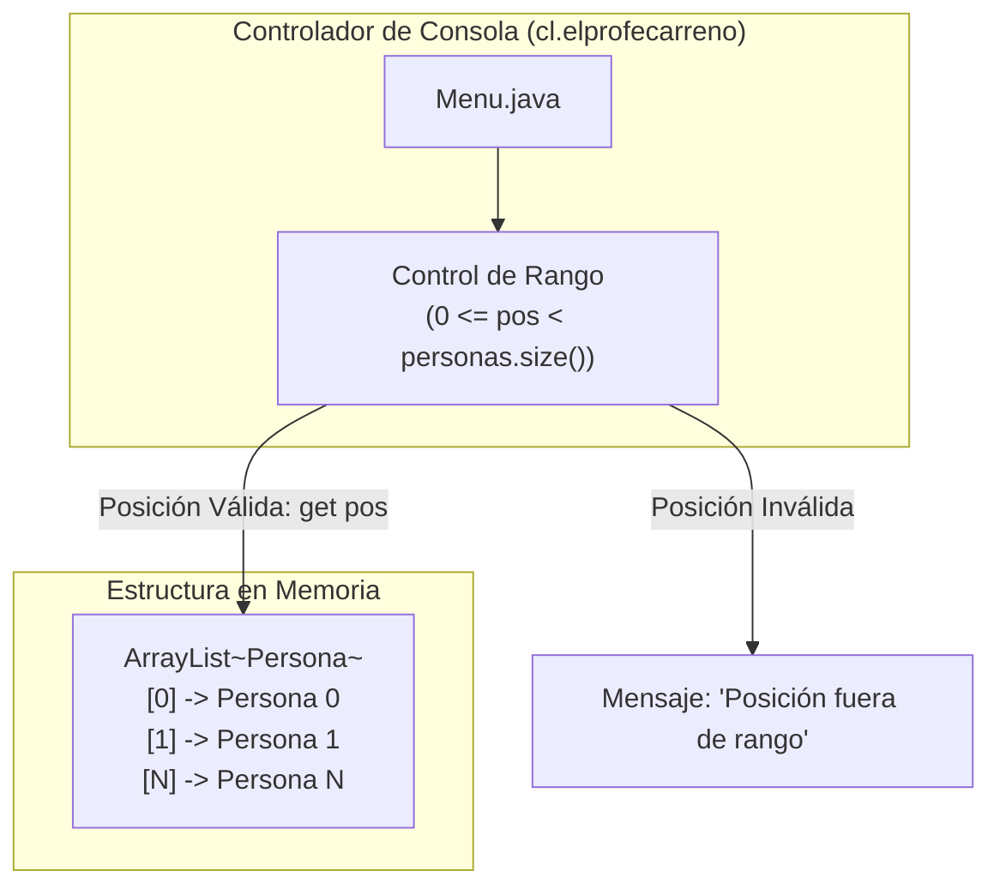
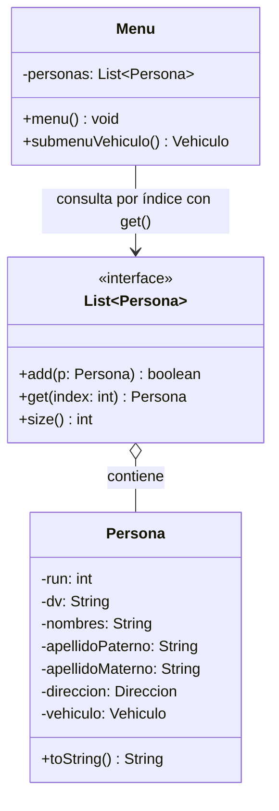
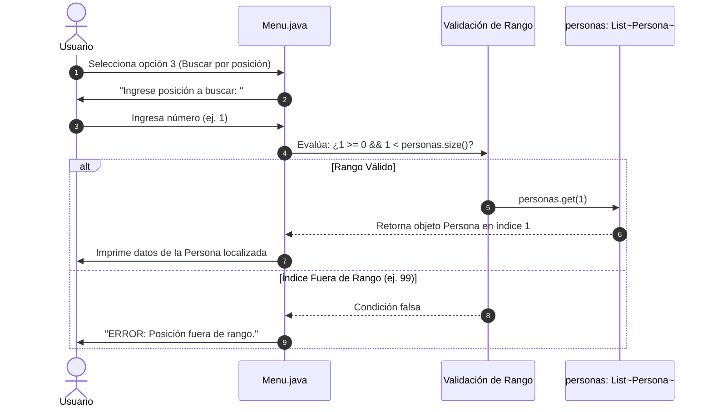

# Proyecto 12 - poo-fundaments (Acceso e Indexación en Colecciones: Buscar por Posición)

Este proyecto introduce las operaciones de **acceso directo e indexado** sobre listas en memoria, abordando el manejo de índices basados en cero (*Zero-Based Indexing*) y la prevención de excepciones de desbordamiento de límites (`IndexOutOfBoundsException`). Constituye el **Hito 12** de la serie incremental.

El objetivo pedagógico es aprender a consultar elementos específicos dentro de una colección `List<Persona>` a través de su posición ordinal (`personas.get(posicion)`), implementando validaciones de rango defensivas antes de acceder a la estructura de datos.

*Video de apoyo:* [Herencia y Polimorfismo (POO) - Parte 11 List (ArrayList)](https://youtu.be/dKSNAUil6ro)

---

## ¿Qué hace el proyecto?

1. Expande el menú principal a 4 opciones:
   - **`1- Crear Persona.`**
   - **`2- Imprimir Datos Persona.`**
   - **`3- Buscar Datos Persona por posición.`** *(Nueva funcionalidad)*
   - **`4- Salir.`**
2. En la opción 3:
   - Solicita al usuario un número entero que representa el índice que desea consultar en la lista (`posicion`).
   - Aplica una **validación de límites defensiva**:
     ```java
     if (posicion >= 0 && posicion < personas.size()) {
         System.out.println(personas.get(posicion).toString());
     } else {
         System.out.println("Posición fuera de rango o la lista está vacía.");
     }
     ```
   - Si la posición es válida, recupera en tiempo constante $O(1)$ la referencia del objeto mediante `personas.get(posicion)` y muestra sus datos completos por consola.
   - Si la posición es menor a cero o mayor o igual al tamaño actual de la lista (`personas.size()`), emite un mensaje amigable al usuario sin provocar la caída del sistema.

---

## Diferencias Clave: Proyecto 12 vs. Proyecto 11

| Componente / Concepto | Proyecto 11 | Proyecto 12 | Beneficio / Justificación |
| :--- | :--- | :--- | :--- |
| **Opciones del Menú** | 3 opciones (Salir era la opción 3). | 4 opciones (incorpora búsqueda por índice; Salir pasa a opción 4). | Amplía las capacidades de consulta selectiva de la interfaz de usuario. |
| **Estrategia de Acceso** | Recorrido exhaustivo secuencial de toda la lista (solo for-each). | Acceso directo indexado por posición mediante el método `get(int index)`. | Permite consultar un registro específico sin necesidad de iterar sobre toda la colección. |
| **Validación de Límites** | Solo verificaba si la lista estaba vacía (`personas.isEmpty()`). | Valida formalmente el rango de índices válidos `[0, personas.size() - 1]`. | Evita que una entrada de índice errónea aborte el programa con `IndexOutOfBoundsException`. |
| **Tiempo de Complejidad** | Recorrido completo $O(N)$. | Acceso aleatorio en $O(1)$ característico de `ArrayList`. | Demuestra la eficiencia de los arreglos dinámicos al consultar por posición de memoria. |

---

## Diagrama de Componentes



---

## Diagrama de Clases



---

## Diagrama de Flujo e Interacción



---

## Paso a Paso para la Construcción Incremental (desde Proyecto 11)

### Paso 1: Actualizar las opciones en `Menu.java`
Edita `src/main/java/cl/elprofecarreno/Menu.java`, ajusta el límite del bucle a `opcion != 4` e incorpora el caso 3:

```java
    public void menu() {
        int opcion = 0;
        List<Persona> personas = new ArrayList<>();
        Scanner sc = new Scanner(System.in);

        while (opcion != 4) {
            System.out.println("\t\t\t MENÚ");
            System.out.println("\n\n1- Crear Persona.");
            System.out.println("\n2- Imprimir Datos Persona.");
            System.out.println("\n3- Buscar Datos Persona por posición.");
            System.out.println("\n4- Salir.");

            opcion = obtenerNumeroTeclado("Selecciona una opción");

            switch (opcion) {
                case 1:
                    // Creación y agregado a personas.add(p)
                    // ...
                    break;

                case 2:
                    // Listado de todas las personas con for-each
                    // ...
                    break;

                case 3:
                    System.out.println("BUSCANDO PERSONA POR POSICIÓN.");
                    if (personas.isEmpty()) {
                        System.out.println("La lista está vacía, no hay registros que buscar.");
                    } else {
                        System.out.println("Rango de posiciones válidas: 0 a " + (personas.size() - 1));
                        int posicion = obtenerNumeroTeclado("Ingrese posición a buscar");

                        if (posicion >= 0 && posicion < personas.size()) {
                            Persona pEncontrada = personas.get(posicion);
                            System.out.println("Persona en posición [" + posicion + "]:");
                            System.out.println(pEncontrada.toString());
                        } else {
                            System.out.println("ERROR: Posición [" + posicion + "] fuera de rango.");
                        }
                    }
                    break;

                case 4:
                    System.out.println("Saliendo del sistema...");
                    break;

                default:
                    System.out.println("Opción no válida.");
            }
        }
    }
```

---

## Estructura del Proyecto

```text
12/
├── README.md
└── abstraccion-encapsulamiento/
    ├── pom.xml
    └── src/
        └── main/
            └── java/
                ├── cl/
                │   ├── elprofecarreno/
                │   │   ├── Main.java
                │   │   ├── Menu.java
                │   │   └── util/
                │   │       └── DateUtil.java
                │   └── profecarreno/
                │       └── dto/
                │           ├── Automovil.java
                │           ├── Direccion.java
                │           ├── Motocicleta.java
                │           ├── Persona.java
                │           └── Vehiculo.java
```

---

## Requisitos y Ejecución

### Requisitos
- **Java JDK**: 21 (o superior).
- **Apache Maven**: 3.8 (o superior).

### Ejecución
```bash
cd 12/abstraccion-encapsulamiento
mvn clean compile exec:java
```

O desde la raíz de `poo-fundaments`:
```bash
mvn -f 12/abstraccion-encapsulamiento/pom.xml clean compile exec:java
```

### Simulación de sesión con búsqueda por posición
```text
			 MENÚ

1- Crear Persona.
2- Imprimir Datos Persona.
3- Buscar Datos Persona por posición.
4- Salir.
Selecciona una opción: 3
BUSCANDO PERSONA POR POSICIÓN.
Rango de posiciones válidas: 0 a 1
Ingrese posición a buscar: 5
ERROR: Posición [5] fuera de rango.

Selecciona una opción: 3
BUSCANDO PERSONA POR POSICIÓN.
Rango de posiciones válidas: 0 a 1
Ingrese posición a buscar: 0
Persona en posición [0]:
Persona{run=11111111, dv=1, nombres=Juan, apellidoPaterno=Soto, apellidoMaterno=López, direccion=..., vehiculo=...}
```

---

## Objetivos Pedagógicos y Buenas Prácticas

- **Indexación basada en 0**: Recordar siempre que en Java el primer elemento de una lista reside en el índice `0` y el último en `size() - 1`.
- **Precondiciones y Validación Defensiva**: Validar siempre los rangos antes de invocar `get(index)` para salvaguardar la robustez del software.
- **Acceso Aleatorio (*Random Access*)**: Comprender por qué `ArrayList` es la estructura idónea cuando se requiere consultar elementos por posición numérica en tiempo constante $O(1)$.
