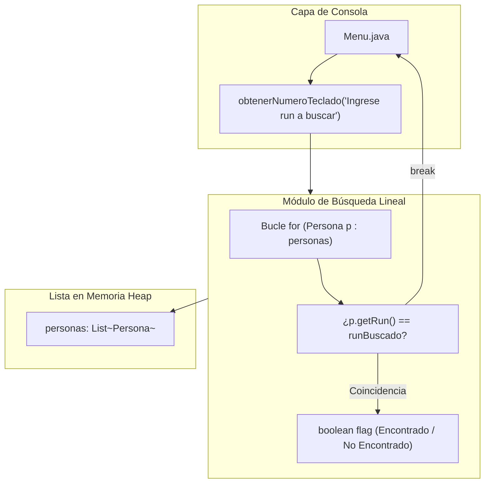
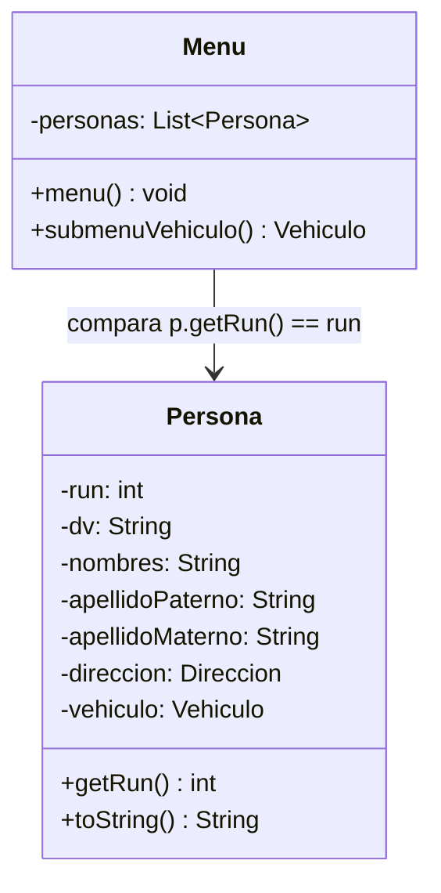
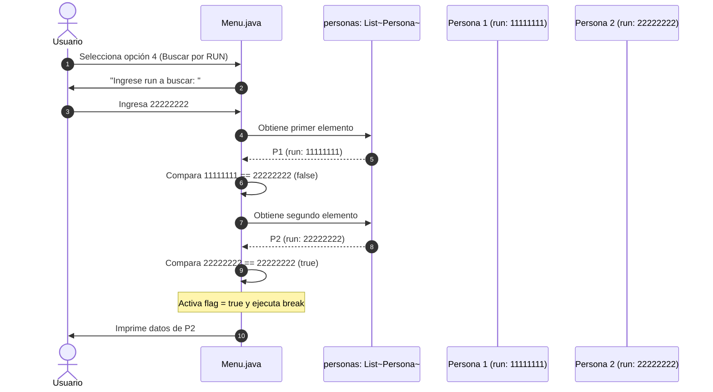

# Proyecto 13 - poo-fundaments (Búsqueda Lineal por Atributo de Negocio: Buscar por RUN)

Este proyecto introduce la implementación de algoritmos de **búsqueda lineal sobre colecciones en memoria**, sustituyendo el acceso artificial por índice técnico por una búsqueda orientada al dominio de negocio basada en el identificador único del ciudadano: el **RUN**. Constituye el **Hito 13** de la serie incremental.

El objetivo pedagógico es comprender la diferencia fundamental entre el índice físico de una estructura de datos (`index` en memoria) y la clave natural o atributo de identidad de una entidad de negocio (`run`), aplicando algoritmos iterativos de búsqueda con banderas de control (*flag*) y optimización de corte temprano (*early exit* con `break`).

*Video de apoyo:* [Herencia y Polimorfismo (POO) - Parte 12 List (ArrayList) Buscar Elementos](https://youtu.be/Wex7C_y-rtY)

---

## ¿Qué hace el proyecto?

1. Expande el menú interactivo a 5 opciones:
   - **`1- Crear Persona.`**
   - **`2- Imprimir Datos Persona.`**
   - **`3- Buscar Datos Persona por posición.`**
   - **`4- Buscar Datos Persona por run.`** *(Nueva funcionalidad de negocio)*
   - **`5- Salir.`**
2. En la opción 4:
   - Solicita al usuario el número de RUN que desea consultar (`runBuscado`).
   - Inicializa una variable de estado booleana (`boolean flag = false`).
   - Itera secuencialmente la lista de personas mediante un bucle `for`:
     ```java
     for (Persona p : personas) {
         if (p.getRun() == runBuscado) {
             System.out.println("Persona encontrada:");
             System.out.println(p.toString());
             flag = true;
             break; // Detiene la búsqueda al encontrar la primera coincidencia
         }
     }
     ```
   - Si tras recorrer la lista la bandera permanece en `false`, notifica al usuario con un mensaje claro: `"La persona con el run [X] no existe en el sistema."`.

---

## Diferencias Clave: Proyecto 13 vs. Proyecto 12

| Componente / Concepto | Proyecto 12 | Proyecto 13 | Beneficio / Justificación |
| :--- | :--- | :--- | :--- |
| **Criterio de Búsqueda** | Búsqueda por índice ordinal de memoria (`posicion`). | Búsqueda semántica por atributo de identidad de negocio (`run`). | Los usuarios del mundo real consultan por su documento de identidad, no por la posición en un arreglo interno. |
| **Algoritmo de Localización** | Acceso directo indexado `personas.get(posicion)`. | **Búsqueda Lineal Iterativa** comparando `p.getRun() == run`. | Permite examinar el contenido interno de las entidades para encontrar coincidencias. |
| **Control de Búsqueda** | Validación de límites numéricos `[0, size-1]`. | Bandera booleana (`flag`) y corte de iteración con instrucción `break`. | Optimización algorítmica: evita recorrer innecesariamente el resto de la lista una vez hallado el registro. |
| **Opciones del Menú** | 4 opciones (Salir en opción 4). | 5 opciones (Salir pasa a opción 5). | Amplía el abanico de operaciones de consulta sobre la colección. |

---

## Diagrama de Componentes



---

## Diagrama de Clases



---

## Diagrama de Flujo e Interacción



---

## Paso a Paso para la Construcción Incremental (desde Proyecto 12)

### Paso 1: Actualizar `Menu.java` incorporando la búsqueda por RUN
Edita `src/main/java/cl/elprofecarreno/Menu.java`, amplía el bucle a `opcion != 5` y agrega la lógica en el `case 4`:

```java
    public void menu() {
        int opcion = 0;
        List<Persona> personas = new ArrayList<>();
        Scanner sc = new Scanner(System.in);

        while (opcion != 5) {
            System.out.println("\t\t\t MENÚ");
            System.out.println("\n\n1- Crear Persona.");
            System.out.println("\n2- Imprimir Datos Persona.");
            System.out.println("\n3- Buscar Datos Persona por posición.");
            System.out.println("\n4- Buscar Datos Persona por run.");
            System.out.println("\n5- Salir.");

            opcion = obtenerNumeroTeclado("Selecciona una opción");

            switch (opcion) {
                case 1:
                    // Creación de Persona...
                    break;
                case 2:
                    // Listado de todas las Personas...
                    break;
                case 3:
                    // Búsqueda por posición en lista...
                    break;
                case 4:
                    System.out.println("BUSCANDO PERSONA POR RUN.");
                    if (personas.isEmpty()) {
                        System.out.println("No hay personas registradas en el sistema.");
                    } else {
                        int runBuscado = obtenerNumeroTeclado("Ingrese run sin dígito verificador a buscar");
                        boolean encontrado = false;

                        for (Persona p : personas) {
                            if (p.getRun() == runBuscado) {
                                System.out.println("¡Persona Encontrada!");
                                System.out.println(p.toString());
                                encontrado = true;
                                break;
                            }
                        }

                        if (!encontrado) {
                            System.out.println("La persona con el RUN " + runBuscado + " no fue encontrada.");
                        }
                    }
                    break;

                case 5:
                    System.out.println("Saliendo del sistema...");
                    break;

                default:
                    System.out.println("Opción no válida.");
            }
        }
    }
```

---

## Estructura del Proyecto

```text
13/
├── README.md
└── abstraccion-encapsulamiento/
    ├── pom.xml
    └── src/
        └── main/
            └── java/
                ├── cl/
                │   ├── elprofecarreno/
                │   │   ├── Main.java
                │   │   ├── Menu.java
                │   │   └── util/
                │   │       └── DateUtil.java
                │   └── profecarreno/
                │       └── dto/
                │           ├── Automovil.java
                │           ├── Direccion.java
                │           ├── Motocicleta.java
                │           ├── Persona.java
                │           └── Vehiculo.java
```

---

## Requisitos y Ejecución

### Requisitos
- **Java JDK**: 21 (o superior).
- **Apache Maven**: 3.8 (o superior).

### Ejecución
```bash
cd 13/abstraccion-encapsulamiento
mvn clean compile exec:java
```

O desde la raíz de `poo-fundaments`:
```bash
mvn -f 13/abstraccion-encapsulamiento/pom.xml clean compile exec:java
```

### Simulación de sesión con búsqueda por clave de negocio
```text
			 MENÚ

1- Crear Persona.
2- Imprimir Datos Persona.
3- Buscar Datos Persona por posición.
4- Buscar Datos Persona por run.
5- Salir.
Selecciona una opción: 4
BUSCANDO PERSONA POR RUN.
Ingrese run sin dígito verificador a buscar: 99999999
La persona con el RUN 99999999 no fue encontrada.

Selecciona una opción: 4
BUSCANDO PERSONA POR RUN.
Ingrese run sin dígito verificador a buscar: 11111111
¡Persona Encontrada!
Persona{run=11111111, dv=1, nombres=Juan, apellidoPaterno=Soto, apellidoMaterno=López, direccion=..., vehiculo=...}
```

---

## Objetivos Pedagógicos y Buenas Prácticas

- **Búsqueda Lineal $O(N)$**: Comprender el costo computacional de buscar secuencialmente sobre listas no indexadas por clave primaria.
- **Identificadores Únicos de Negocio**: Identificar campos que diferencian unívocamente a los objetos en el dominio real frente a índices internos volátiles de un arreglo.
- **Uso de Banderas y `break`**: Aplicar patrones de control de flujo limpios para comunicar el éxito o fracaso de operaciones de búsqueda.
