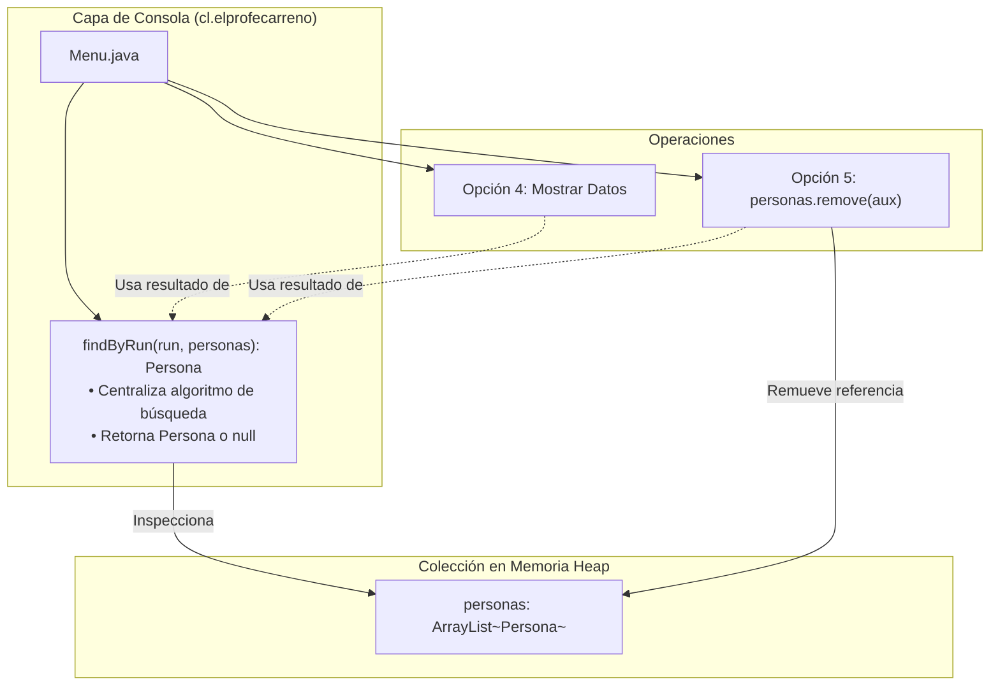
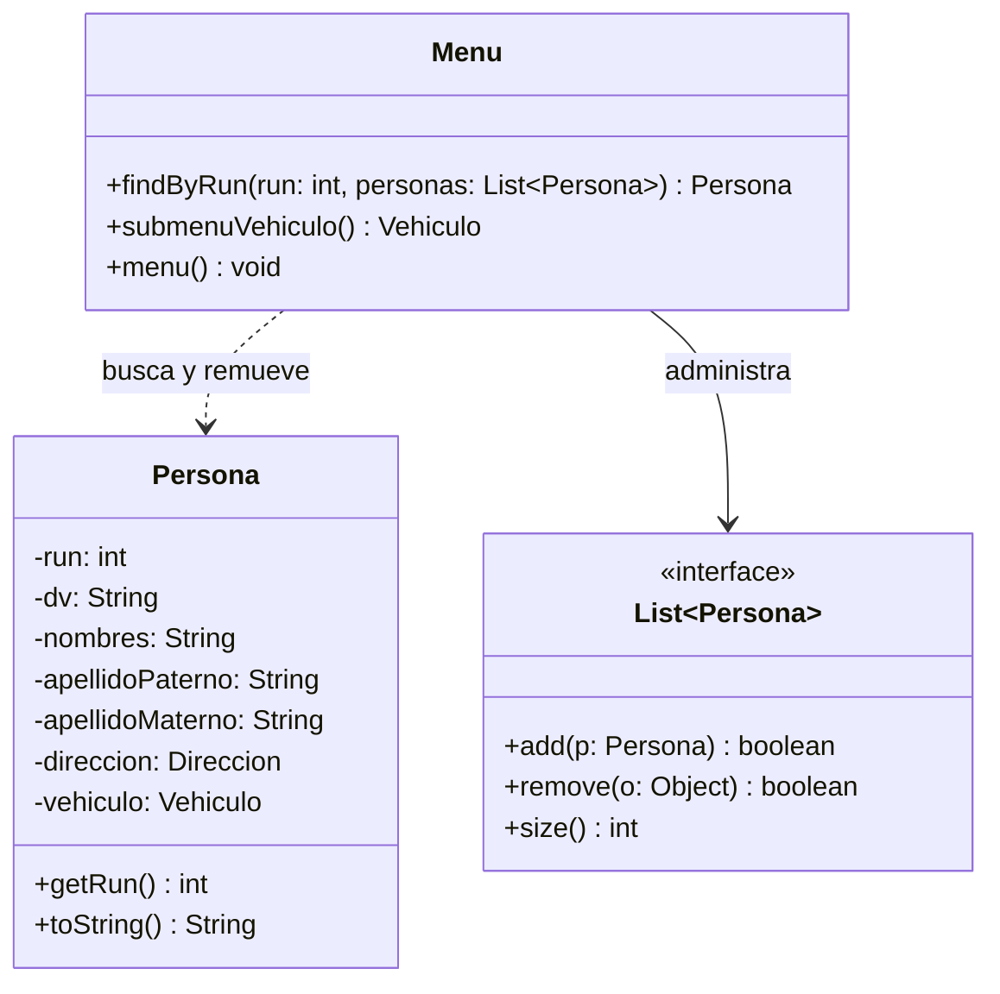
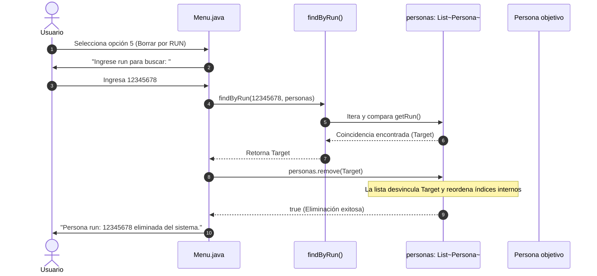

# Proyecto 14 - poo-fundaments (Gestión de Colecciones: Búsqueda y Eliminación por RUN)

Este proyecto introduce la operación destructiva de **eliminación de elementos en memoria** sobre colecciones `List<Persona>` y la modularización algorítmica mediante la creación del método reutilizable **`findByRun`**. Constituye el **Hito 14** de la serie incremental.

El objetivo pedagógico es aprender a estructurar operaciones CRUD mediante métodos especializados, desacoplando la búsqueda de la acción subsiguiente (mostrar o borrar), y dominando la remoción física de referencias de objetos de una lista mediante el método `personas.remove(Object)`.

*Video de apoyo:* [Herencia y Polimorfismo (POO) - Parte 13 List (ArrayList) Buscar y Eliminar Elementos](https://youtu.be/fhS5cdv59kU)

---

## ¿Qué hace el proyecto?

1. Modulariza la lógica de búsqueda extrayéndola del cuerpo de `menu()` hacia un método público e independiente:
   ```java
   public Persona findByRun(int run, List<Persona> personas)
   ```
   Este método itera la lista con un bucle `while` controlado por bandera, retornando la referencia a la `Persona` encontrada o `null` si no existe coincidencia.
2. Refactoriza la opción **`4- Buscar Datos Persona por run`** para reutilizar `findByRun`, simplificando radicalmente el bloque `case 4`.
3. Introduce la opción **`5- Buscar Persona por run y Borrar.`**:
   - Solicita el RUN a eliminar.
   - Invoca a `findByRun(runRemove, personas)` para obtener la referencia del objeto objetivo.
   - Si retorna `null`, alerta con `"ERROR: Persona no existe en la lista."`.
   - Si la persona existe, invoca `personas.remove(auxRemove)`, eliminando la referencia de la lista en memoria y compactando los índices internos de `ArrayList`.
   - Notifica la eliminación exitosa y el nuevo estado de la lista.
4. Ajusta la salida del programa a la opción **`6- Salir`**.

---

## Diferencias Clave: Proyecto 14 vs. Proyecto 13

| Componente / Concepto | Proyecto 13 | Proyecto 14 | Beneficio / Justificación |
| :--- | :--- | :--- | :--- |
| **Modularización de Búsqueda** | Búsqueda escrita directamente dentro del `switch` en `case 4`. | Extraída al método reusable `findByRun(int run, List<Persona> personas)`. | **Principio DRY (Don't Repeat Yourself)**: centraliza la lógica de consulta para que tanto la búsqueda como la eliminación la reutilicen. |
| **Operación de Eliminación** | No existía capacidad de borrar registros. | Introduce la opción 5 y el método `personas.remove(auxRemove)`. | Incorpora la "D" (*Delete*) del ciclo CRUD, permitiendo depurar la colección en tiempo de ejecución. |
| **Gestión de Referencias en Heap** | Los objetos permanecían en la lista hasta el fin del proceso. | Al eliminar la referencia de la lista, el objeto queda disponible para el recolector de basura (*Garbage Collector*). | Gestión eficiente de recursos y liberación de memoria. |
| **Opciones del Menú** | 5 opciones (Salir era 5). | 6 opciones (Salir pasa a ser la opción 6). | Evolución progresiva de la interfaz de consola hacia un CRUD completo. |

---

## Diagrama de Componentes



---

## Diagrama de Clases



---

## Diagrama de Flujo e Interacción



---

## Paso a Paso para la Construcción Incremental (desde Proyecto 13)

### Paso 1: Implementar el método modular `findByRun` en `Menu.java`
Edita `src/main/java/cl/elprofecarreno/Menu.java` y añade la función de búsqueda:

```java
    public Persona findByRun(int run, List<Persona> personas) {
        Persona aux = null;
        boolean flag = true;
        int i = 0;
        while (flag && i < personas.size()) {
            if (personas.get(i).getRun() == run) {
                aux = personas.get(i);
                flag = false;
            }
            i++;
        }
        return aux;
    }
```

### Paso 2: Refactorizar la opción 4 y añadir la opción 5 en `menu()`
Actualiza el bucle y la estructura `switch-case`:

```java
    public void menu() {
        int opcion = 0;
        List<Persona> personas = new ArrayList<>();
        Scanner sc = new Scanner(System.in);

        while (opcion != 6) {
            System.out.println("\t\t\t MENÚ");
            System.out.println("\n\n1- Crear Persona.");
            System.out.println("\n2- Imprimir Datos Persona.");
            System.out.println("\n3- Buscar Datos Persona por posición.");
            System.out.println("\n4- Buscar Datos Persona por run.");
            System.out.println("\n5- Buscar Persona por run y Borrar.");
            System.out.println("\n6- Salir.");

            opcion = obtenerNumeroTeclado("Selecciona una opción");

            switch (opcion) {
                // Casos 1, 2 y 3 se mantienen iguales...

                case 4:
                    int runBuscar = obtenerNumeroTeclado("Ingrese run sin DV a buscar");
                    Persona pEncontrada = findByRun(runBuscar, personas);
                    if (pEncontrada != null) {
                        System.out.println("Persona encontrada:");
                        System.out.println(pEncontrada.toString());
                    } else {
                        System.out.println("ERROR: Persona no existe en la lista.");
                    }
                    break;

                case 5:
                    int runRemove = obtenerNumeroTeclado("Ingrese run para buscar y borrar");
                    Persona auxRemove = findByRun(runRemove, personas);

                    if (auxRemove == null) {
                        System.out.println("ERROR: Persona no existe en la lista.");
                    } else {
                        personas.remove(auxRemove);
                        System.out.println("Persona run: " + runRemove + " eliminada del sistema.");
                    }
                    break;

                case 6:
                    System.out.println("Saliendo del programa...");
                    break;

                default:
                    System.out.println("Opción no válida.");
            }
        }
    }
```

---

## Estructura del Proyecto

```text
14/
├── README.md
└── abstraccion-encapsulamiento/
    ├── pom.xml
    └── src/
        └── main/
            └── java/
                ├── cl/
                │   ├── elprofecarreno/
                │   │   ├── Main.java
                │   │   ├── Menu.java
                │   │   └── util/
                │   │       └── DateUtil.java
                │   └── profecarreno/
                │       └── dto/
                │           ├── Automovil.java
                │           ├── Direccion.java
                │           ├── Motocicleta.java
                │           ├── Persona.java
                │           └── Vehiculo.java
```

---

## Requisitos y Ejecución

### Requisitos
- **Java JDK**: 21 (o superior).
- **Apache Maven**: 3.8 (o superior).

### Ejecución
```bash
cd 14/abstraccion-encapsulamiento
mvn clean compile exec:java
```

O desde la raíz de `poo-fundaments`:
```bash
mvn -f 14/abstraccion-encapsulamiento/pom.xml clean compile exec:java
```

### Simulación de sesión con eliminación por RUN
```text
			 MENÚ

1- Crear Persona.
2- Imprimir Datos Persona.
3- Buscar Datos Persona por posición.
4- Buscar Datos Persona por run.
5- Buscar Persona por run y Borrar.
6- Salir.
Selecciona una opción: 5
Ingrese run para buscar y borrar: 11111111
Persona run: 11111111 eliminada del sistema.

Selecciona una opción: 4
Ingrese run sin DV a buscar: 11111111
ERROR: Persona no existe en la lista.
```

---

## Objetivos Pedagógicos y Buenas Prácticas

- **Reutilización y Desacoplamiento**: Separar la búsqueda del borrado permite que cualquier nueva operación (actualizar, exportar) reutilice `findByRun`.
- **Eliminación por Referencia de Objeto**: Entender cómo `List.remove(Object)` busca la primera ocurrencia basada en igualdad y reorganiza los punteros internos de la lista.
- **Gestión de Ciclo de Vida**: Concluir que al no existir más referencias apuntando al objeto borrado, este se vuelve elegible para ser recolectado por el Garbage Collector de la JVM.
