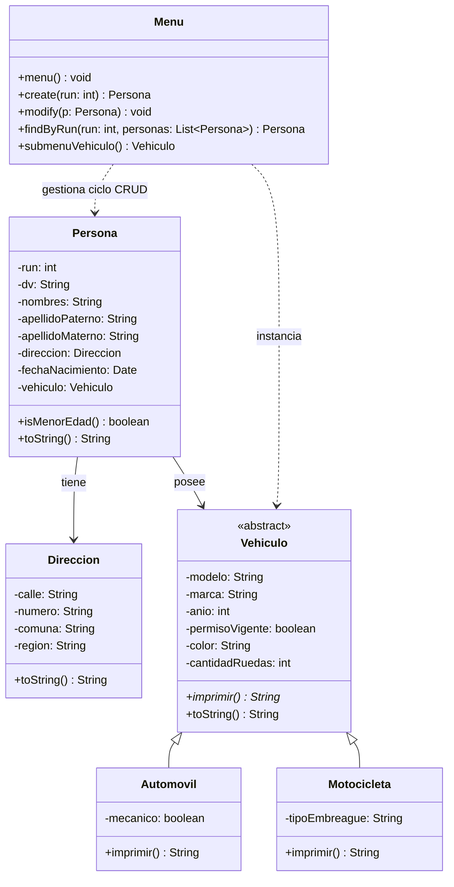

# Proyecto 15 - poo-fundaments (Ciclo CRUD Completo en Memoria y Refactorización Modular)

Este proyecto constituye el **cierre y culminación (Hito 15)** de la serie incremental de fundamentos de Programación Orientada a Objetos. En él se completa el ciclo completo **CRUD en Memoria** (**C**reate, **R**ead, **U**pdate, **D**elete) incorporando la modificación de registros existentes y aplicando una refactorización modular profunda orientada a la reutilización y limpieza de código (*Clean Code*).

El objetivo pedagógico es dominar la actualización atómica del estado de un objeto en memoria mediante mutación por referencia (`modify(Persona p)`), modularizar las responsabilidades de creación (`create(int run)`), desacoplar la interfaz de usuario de las operaciones de negocio y comprender cómo una aplicación de consola puede gestionar un ciclo de vida de datos completo.

*Video de apoyo:* [15 - Herencia y Polimorfismo (POO) - Parte 14 List (ArrayList) Buscar y Actualizar Elementos](https://youtu.be/Zx6MDouKL-A)  
*Repositorio oficial:* [GitHub Proyecto 15](https://github.com/elprofecarreno/poo-fundaments/tree/main/15)

---

## ¿Qué hace el proyecto?

1. Refactoriza la clase controladora `Menu.java` extrayendo responsabilidades complejas a métodos especializados:
   - **`findByRun(int run, List<Persona> personas)`**: Algoritmo central de localización por RUN.
   - **`create(int run)`**: Centraliza la captura interactiva completa de una persona, solicitando datos de identidad, domicilio (`Direccion`), fecha de nacimiento validada (`DateUtil`) y medio de transporte polimórfico (`Vehiculo` vía `submenuVehiculo()`), retornando la nueva instancia ensamblada.
   - **`modify(Persona p)`**: Recibe la referencia de una persona existente, reutiliza `create(p.getRun())` para capturar los nuevos valores y actualiza selectivamente sus atributos (`nombres`, `apellidos`, `direccion`, `vehiculo`) en la misma posición de memoria, preservando el RUN.
2. Presenta un menú completo de 7 opciones (con convención estándar `0- Salir`):
   - **`1- Crear Persona.`**
   - **`2- Imprimir Datos Persona.`**
   - **`3- Buscar Datos Persona por posición.`**
   - **`4- Buscar Datos Persona por run.`**
   - **`5- Buscar Persona por run y Borrar.`**
   - **`6- Buscar Persona por run y Actualizar.`** *(Nueva funcionalidad CRUD: Update)*
   - **`0- Salir.`**
3. En la opción 6 (Actualizar):
   - Solicita el RUN a modificar y busca la persona con `findByRun`.
   - Si no existe, muestra un mensaje de error.
   - Si existe, delega en `modify(pEncontrada)`, solicitando los nuevos datos e impactando inmediatamente la lista sin necesidad de eliminar y reinsertar.

---

## Diferencias Clave: Proyecto 15 vs. Proyecto 14

| Componente / Concepto | Proyecto 14 | Proyecto 15 | Beneficio / Justificación |
| :--- | :--- | :--- | :--- |
| **Ciclo CRUD Completo** | CRUD Parcial (Create, Read, Delete). Faltaba la "U" (*Update*). | **CRUD Completo en Memoria**: incorpora la opción 6 de Actualización / Modificación. | Permite corregir o actualizar la información de personas registradas manteniendo la integridad de la lista. |
| **Modularización de Creación** | Más de 25 líneas repetidas dentro del `switch` en `case 1`. | Extraído al método `create(int run): Persona`. | Alta reutilización: `modify()` puede reaprovechar `create()` para solicitar los nuevos datos sin duplicar código. |
| **Actualización por Referencia** | Inexistente. | Método `modify(Persona p)` muta los campos del objeto existente en el heap. | Eficiencia: no requiere reubicar ni reorganizar los punteros internos del `ArrayList`. |
| **Convención de Salida** | Salir era la opción 6. | Estandarización a la convención universal de consolas: `0- Salir`. | Mayor intuición y ergonomía para el usuario final. |

---

## Diagrama de Componentes

```mermaid
flowchart TB
    subgraph UI_Console["Capa de Presentación y Flujo (Menu.java)"]
        MenuLoop["menu()\n• Bucle while (opcion != 0)\n• Switch-case modular"]
        CreateMethod["create(int run): Persona\n• Captura Persona\n• Captura Direccion\n• Invoca submenuVehiculo()"]
        ModifyMethod["modify(Persona p)\n• Actualiza campos en el Heap"]
        FindMethod["findByRun(run, personas): Persona"]
        SubMenu["submenuVehiculo(): Vehiculo"]
    end

    subgraph Collections_Memory["Colección en Memoria"]
        ListaPersonas["List~Persona~ personas\n• add(p)\n• remove(p)\n• get(i)\n• for-each"]
    end

    subgraph Dominio_Completo["Paquete cl.profecarreno.dto"]
        Persona["Persona"]
        Direccion["Direccion"]
        Vehiculo["Vehiculo <<abstract>>"]
        Automovil["Automovil"]
        Motocicleta["Motocicleta"]
    end

    MenuLoop --> CreateMethod
    MenuLoop --> ModifyMethod
    MenuLoop --> FindMethod
    ModifyMethod --> CreateMethod
    CreateMethod --> SubMenu
    CreateMethod --> Persona
    Persona --> Direccion
    Persona --> Vehiculo
    Vehiculo <|-- Automovil
    Vehiculo <|-- Motocicleta
    MenuLoop -->|Gestiona| ListaPersonas
```

---

## Diagrama de Clases



---

## Diagrama de Flujo e Interacción: Ciclo de Actualización

```mermaid
sequenceDiagram
    autonumber
    actor Usuario
    participant Menu as Menu.java
    participant Find as findByRun()
    participant Modify as modify(p)
    participant Create as create(run)
    participant Target as Persona objetivo (en Heap)

    Usuario->>Menu: Selecciona opción 6 (Buscar por RUN y Actualizar)
    Menu->>Usuario: "Ingrese run a buscar: "
    Usuario->>Menu: Ingresa 12345678
    
    Menu->>Find: findByRun(12345678, personas)
    Find-->>Menu: Retorna Target (instancia existente)

    Menu->>Modify: modify(Target)
    Modify->>Create: create(Target.getRun())
    Create->>Usuario: Solicita nuevos nombres, dirección, vehículo...
    Usuario->>Create: Proporciona nuevos datos
    Create-->>Modify: Retorna objeto auxiliar con nuevos datos

    Note over Modify, Target: Mutación atómica en el Heap sin cambiar identidad
    Modify->>Target: setNombres(aux.getNombres())
    Modify->>Target: setApellidoPaterno(aux.getApellidoPaterno())
    Modify->>Target: setDireccion(aux.getDireccion())
    Modify->>Target: setVehiculo(aux.getVehiculo())
    Modify-->>Menu: Actualización completada

    Menu->>Usuario: "Persona actualizada exitosamente."
```

---

## Paso a Paso para la Construcción Incremental (desde Proyecto 14)

### Paso 1: Implementar los métodos modulares `create` y `modify` en `Menu.java`
Edita `src/main/java/cl/elprofecarreno/Menu.java`:

```java
    public Persona create(int run) {
        String dv = obtenerTextoTeclado("Ingrese dígito verificador");
        String nombres = obtenerTextoTeclado("Ingrese nombres");
        String apellidoPaterno = obtenerTextoTeclado("Apellido paterno");
        String apellidoMaterno = obtenerTextoTeclado("Apellido materno");

        System.out.println("CREANDO DIRECCIÓN.");
        String calle = obtenerTextoTeclado("calle");
        String numero = obtenerTextoTeclado("número");
        String comuna = obtenerTextoTeclado("comuna");
        String region = obtenerTextoTeclado("región");
        Date fechaNacimiento = obtenerDateTeclado("Ingrese la fecha de nacimiento (dd/mm/yyyy)");

        Direccion d = new Direccion(calle, numero, comuna, region);
        Vehiculo v = submenuVehiculo();

        return new Persona(run, dv, nombres, apellidoPaterno, apellidoMaterno, d, fechaNacimiento, v);
    }

    public void modify(Persona p) {
        System.out.println("Actualizando datos para el RUN: " + p.getRun());
        Persona aux = create(p.getRun());
        p.setDv(aux.getDv());
        p.setNombres(aux.getNombres());
        p.setApellidoPaterno(aux.getApellidoPaterno());
        p.setApellidoMaterno(aux.getApellidoMaterno());
        p.setDireccion(aux.getDireccion());
        p.setFechaNacimiento(aux.getFechaNacimiento());
        p.setVehiculo(aux.getVehiculo());
    }
```

### Paso 2: Integrar el ciclo CRUD completo en `menu()`
Ajusta la salida a `opcion != 0` y añade el `case 6`:

```java
    public void menu() {
        int opcion = -1;
        List<Persona> personas = new ArrayList<>();

        while (opcion != 0) {
            System.out.println("\t\t\t MENÚ");
            System.out.println("\n\n1- Crear Persona.");
            System.out.println("\n2- Imprimir Datos Persona.");
            System.out.println("\n3- Buscar Datos Persona por posición.");
            System.out.println("\n4- Buscar Datos Persona por run.");
            System.out.println("\n5- Buscar Persona por run y Borrar.");
            System.out.println("\n6- Buscar Persona por run y Actualizar.");
            System.out.println("\n0- Salir.");

            opcion = obtenerNumeroTeclado("Selecciona una opción");

            switch (opcion) {
                case 1:
                    System.out.println("CREANDO PERSONA.");
                    int run = obtenerNumeroTeclado("Ingrese run sin dígito verificador");
                    Persona nueva = create(run);
                    personas.add(nueva);
                    System.out.println("Persona agregada exitosamente.");
                    break;

                case 2:
                    System.out.println("LISTADO DE PERSONAS:");
                    if (personas.isEmpty()) {
                        System.out.println("No hay personas registradas.");
                    } else {
                        for (Persona p : personas) {
                            System.out.println(p.toString());
                        }
                    }
                    break;

                case 3:
                    // Buscar por posición...
                    break;

                case 4:
                    int runBuscar = obtenerNumeroTeclado("Ingrese run a buscar");
                    Persona encontrada = findByRun(runBuscar, personas);
                    if (encontrada != null) {
                        System.out.println(encontrada.toString());
                    } else {
                        System.out.println("Persona no existe.");
                    }
                    break;

                case 5:
                    int runBorrar = obtenerNumeroTeclado("Ingrese run a borrar");
                    Persona aBorrar = findByRun(runBorrar, personas);
                    if (aBorrar != null) {
                        personas.remove(aBorrar);
                        System.out.println("Persona eliminada.");
                    } else {
                        System.out.println("Persona no encontrada.");
                    }
                    break;

                case 6:
                    int runModificar = obtenerNumeroTeclado("Ingrese run a modificar");
                    Persona aModificar = findByRun(runModificar, personas);
                    if (aModificar != null) {
                        modify(aModificar);
                        System.out.println("Persona actualizada exitosamente.");
                    } else {
                        System.out.println("Persona no encontrada.");
                    }
                    break;

                case 0:
                    System.out.println("¡Hasta luego!");
                    break;

                default:
                    System.out.println("Opción inválida.");
            }
        }
    }
```

---

## Estructura del Proyecto

```text
15/
├── README.md
└── abstraccion-encapsulamiento/
    ├── pom.xml
    └── src/
        └── main/
            └── java/
                ├── cl/
                │   ├── elprofecarreno/
                │   │   ├── Main.java
                │   │   ├── Menu.java
                │   │   └── util/
                │   │       └── DateUtil.java
                │   └── profecarreno/
                │       └── dto/
                │           ├── Automovil.java
                │           ├── Direccion.java
                │           ├── Motocicleta.java
                │           ├── Persona.java
                │           └── Vehiculo.java
```

---

## Requisitos y Ejecución

### Requisitos
- **Java JDK**: 21 (o superior).
- **Apache Maven**: 3.8 (o superior).

### Ejecución
```bash
cd 15/abstraccion-encapsulamiento
mvn clean compile exec:java
```

O desde la raíz de `poo-fundaments`:
```bash
mvn -f 15/abstraccion-encapsulamiento/pom.xml clean compile exec:java
```

### Simulación de sesión con actualización
```text
			 MENÚ

1- Crear Persona.
2- Imprimir Datos Persona.
3- Buscar Datos Persona por posición.
4- Buscar Datos Persona por run.
5- Buscar Persona por run y Borrar.
6- Buscar Persona por run y Actualizar.
0- Salir.
Selecciona una opción: 6
Ingrese run a modificar: 12345678
Actualizando datos para el RUN: 12345678
Ingrese dígito verificador: 9
Ingrese nombres: María Elena
Apellido paterno: Pérez
Apellido materno: González
CREANDO DIRECCIÓN.
calle: Nueva Providencia
número: 2155
comuna: Providencia
región: RM
Ingrese la fecha de nacimiento (dd/mm/yyyy): 12/04/1995
...
Persona actualizada exitosamente.
```

---

## Objetivos Pedagógicos y Buenas Prácticas

- **Cierre del Ciclo CRUD**: Consolidar el dominio de las 4 operaciones esenciales de gestión de entidades en memoria.
- **Mutación de Estado en Memoria**: Entender la potencia del paso de referencias por valor en Java: modificar los atributos de `p` altera directamente la instancia compartida en la lista `personas`.
- **Refactorización y DRY**: Observar cómo modularizar la lógica en métodos cohesivos (`create`, `modify`, `findByRun`) reduce drásticamente la complejidad ciclomática de `menu()`.
- **Base para la Persistencia Externa**: Comprender que este modelo en memoria es el precursor directo para la persistencia en archivos (JSON con Gson) o bases de datos relacionales abordadas en proyectos posteriores.
