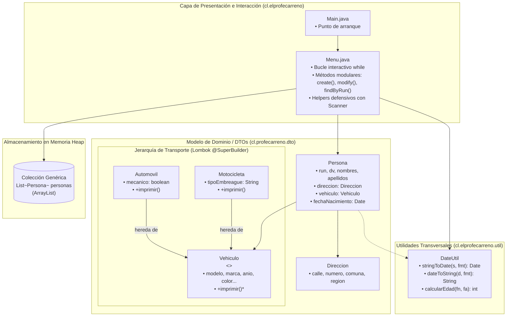

# POO Fundamentos con Java, Maven y Programación en Consola

Este repositorio contiene una serie de proyectos prácticos e incrementales de **Programación Orientada a Objetos en Java con Apache Maven**, organizados secuencialmente desde la carpeta `01` hasta la `15`.

Cada proyecto avanza progresivamente sobre la base del anterior, abordando los fundamentos de la ingeniería de software y los cuatro pilares de la POO: **Abstracción, Encapsulamiento, Composición y Asociación** (`Persona` posee `Direccion`), **Herencia y Polimorfismo** (jerarquía abstracta de `Vehiculo` especializada en `Automovil` y `Motocicleta`), diseño de **Clases Utilitarias** (`DateUtil` para formateo y cálculo de edad cronológica), reducción de código repetitivo con **Project Lombok** (`@Data`, `@Getter`, `@Setter`, `@AllArgsConstructor`, `@NoArgsConstructor`), el **Patrón Creacional Builder** con `@SuperBuilder` para herencia fluida, **Programación Defensiva** en terminal con `java.util.Scanner` para captura tolerante a fallos (`try-catch`), gestión de **Colecciones Dinámicas en Memoria** (`java.util.List` y `ArrayList`), algoritmos de búsqueda lineal y por posición, y el cierre definitivo del **ciclo CRUD completo en memoria** (**C**reate, **R**ead, **U**pdate, **D**elete).

---

## Herramientas e Instalación

### Videos de instalación:
- [Instalación Apache Netbeans en Windows](https://youtu.be/FyIqizc9t0k)
- [Instalación Apache Netbeans en Linux](https://youtu.be/gBkCYiTq6ro)
- [Instalación JDK + Maven en Windows](https://youtu.be/8gooYj4gQ-Q)
- [Instalación JDK + Maven en Linux](https://youtu.be/X0TGKU0gBRc)

### Repositorios instaladores:
- [Visual Code Instalador en Linux !!!](https://github.com/elprofecarreno/visual-code-linux-install)

---

## Hoja de Ruta de Evolución Incremental

El siguiente diagrama ilustra cómo cada hito construye y refina las capacidades del sistema:

```mermaid
flowchart TD
    P01["01 - Entorno Base\n• Verificación JDK 21 y Maven\n• Clase Main ejecutable\n• Salida estándar Hello World!"]
    P02["02 - Abstracción y Encapsulamiento\n• Entidad de dominio Persona\n• Atributos privados y métodos get/set\n• Constructores sobrecargados y toString()"]
    P03["03 - Reducción con Lombok\n• Integración de Project Lombok (provided)\n• Anotaciones @Getter, @Setter, @ToString\n• Eliminación drástica de código boilerplate"]
    P04["04 - Diseño Conceptual de Clases\n• Diagrama UML en diagrama-clases.png\n• Modelado de Asociación / Composición\n• Persona posee Direccion (Principio SRP)"]
    P05["05 - Composición en Java\n• Creación de entidad Direccion con Lombok\n• Campo Direccion direccion en Persona\n• Vinculación de referencias de objetos"]
    P06["06 - Utilitarios y Fechas\n• Subpaquete util y clase DateUtil\n• Constructor privado e inmutabilidad\n• Cálculo de edad con java.time.Period\n• Método de negocio isMenorEdad()"]
    P07["07 - Menú y Paquete DTO\n• Reorganización a cl.profecarreno.dto\n• Menú interactivo en consola con Scanner\n• Opciones Crear, Listar y Salir"]
    P08["08 - Entrada Robusta y Defensiva\n• Métodos auxiliares de lectura de teclado\n• Control defensivo con try-catch y sc.next()\n• Captura interactiva de Direccion completa"]
    P09["09 - Herencia y Polimorfismo\n• Clase abstracta Vehiculo (+imprimir())\n• Subclases Automovil y Motocicleta\n• Persona posee Vehiculo (asociación)\n• Submenú interactivo polimórfico"]
    P10["10 - Patrón Creacional Builder\n• Lombok @SuperBuilder en jerarquía\n• Construcción fluida y atómica de vehículos\n• Eliminación de setters dispersos"]
    P11["11 - Colecciones en Memoria (List)\n• Transición a List~Persona~ y ArrayList\n• Inserción dinámica con personas.add(p)\n• Recorrido e impresión con for-each"]
    P12["12 - Consulta por Posición\n• Acceso aleatorio con personas.get(i)\n• Validación defensiva de límites [0, size-1]\n• Control de IndexOutOfBoundsException"]
    P13["13 - Búsqueda Lineal por RUN\n• Búsqueda por clave de identidad de negocio\n• Iteración lineal comparando getRun()\n• Control de flujo con bandera y break"]
    P14["14 - Eliminación por RUN\n• Método modular findByRun(run, personas)\n• Borrado físico con personas.remove(aux)\n• Liberación de referencias para Garbage Collector"]
    P15["15 - Ciclo CRUD Completo y Refactorización\n• Opción de modificación con modify(Persona)\n• Método modular de captura create(run)\n• Ciclo CRUD completo en memoria (0- Salir)"]

    P01 --> P02
    P02 --> P03
    P03 --> P04
    P04 --> P05
    P05 --> P06
    P06 --> P07
    P07 --> P08
    P08 --> P09
    P09 --> P10
    P10 --> P11
    P11 --> P12
    P12 --> P13
    P13 --> P14
    P14 --> P15
```



---

## Índice de Proyectos y Documentación Detallada

Cada carpeta contiene su propio proyecto Maven ejecutable y un `README.md` exhaustivo con diagramas de componentes, diagramas de clases UML, diagramas de secuencia/flujo, comparativas de diferencias respecto al hito previo, guía paso a paso y comandos de ejecución:

- [**01 - Hello World**](01/README.md)  
  Proyecto inicial para verificar que el compilador JDK 21 y Maven funcionan correctamente. Valida el descriptor `pom.xml`, el empaquetado y la ejecución por consola.  
  *Video:* [Primer Proyecto Hello World!!!](https://youtu.be/CBQbfG04zjU)

- [**02 - Abstracción y Encapsulamiento Básico**](02/README.md)  
  Introducción a los dos primeros pilares de la POO mediante la entidad `Persona`, aplicando atributos privados, métodos de acceso y mutación (getters y setters), constructores sobrecargados y `toString()`.  
  *Video:* [Abtracción y Encapsulamiento (POO)](https://youtu.be/dznHdkDOYi8)

- [**03 - Encapsulamiento con Lombok**](03/README.md)  
  Integración de **Project Lombok** en Maven (`provided`) para eliminar código repetitivo (*boilerplate*). Refactorización de `Persona` decorada con `@Getter`, `@Setter`, `@ToString`, `@NoArgsConstructor` y `@AllArgsConstructor`.  
  *Video:* [Abtracción y Encapsulamiento (POO) - Parte 2 lombok](https://youtu.be/bifiaIAJZbs)

- [**04 - Diagrama de Clases de Persona y Dirección**](04/README.md)  
  Hito de modelado conceptual arquitectónico previo a la codificación. Documenta la relación estructural de asociación/composición entre `Persona` y su domicilio `Direccion` a través de UML formal (`diagrama-clases.png`).  
  *Video:* [Abtracción y Encapsulamiento (POO) - Parte 3 Diagrama de Clases](https://youtu.be/k-t4vigvG28)

- [**05 - Persona con Dirección (Composición de Clases)**](05/README.md)  
  Implementación en Java del diseño modelado en el Hito 04. Creación de la clase `Direccion` con Lombok y adición del campo `private Direccion direccion` en `Persona`, vinculando objetos colaboradores en el Heap.  
  *Video:* [Abtracción y Encapsulamiento (POO) - Parte 4 Colaboración o Composición de Clases](https://youtu.be/OSn6Iw2EnVc)

- [**06 - Persona, Dirección y Utilidades de Fecha (DateUtil)**](06/README.md)  
  Creación del paquete utilitario `cl.elprofecarreno.util` y la clase inmutable `DateUtil`. Conversión de fechas con `SimpleDateFormat` y cálculo cronológico de edad con la API moderna `java.time.Period`. Incorporación del método `isMenorEdad()` en `Persona`.  
  *Video:* [Abtracción y Encapsulamiento (POO) - Parte 5 Fechas y Librerias](https://youtu.be/aOBPgSGgiZU)

- [**07 - Menú y Reorganización en DTO**](07/README.md)  
  Evolución hacia aplicaciones interactivas conducidas por el usuario. Reorganización de las entidades al paquete `cl.profecarreno.dto` y creación de `Menu.java` con ciclo continuo `Scanner` (1- Crear, 2- Listar, 3- Salir).  
  *Video:* [Abtracción y Encapsulamiento (POO) - Parte 6 Menú](https://youtu.be/xM57KC2hP00)

- [**08 - Entrada Robusta, Captura Defensiva y Composición en Menú**](08/README.md)  
  Aplicación de **Programación Defensiva** en consola para capturar errores de usuario (`InputMismatchException`) mediante métodos auxiliares (`obtenerNumeroTeclado` y `obtenerTextoTeclado`) con bucles `try-catch`, e integración interactiva de `Direccion`.  
  *Video:* [Abtracción y Encapsulamiento (POO) - Parte 7 Menú.](https://youtu.be/a44sjVPWv0I)

- [**09 - Herencia y Polimorfismo: Jerarquía de Vehículos**](09/README.md)  
  Modelado formal de los pilares de Herencia y Polimorfismo. Clase base abstracta `Vehiculo` y subclases concretas `Automovil` y `Motocicleta`. Asociación polimórfica en `Persona` (`vehiculo: Vehiculo`) y submenú interactivo `submenuVehiculo()`.  
  *Video:* [Herencia y Polimorfismo (POO) - Parte 8 Menú.](https://youtu.be/tH4_teMTTO0)

- [**10 - Patrón Creacional Builder con Lombok @SuperBuilder**](10/README.md)  
  Integración del patrón creacional **Builder** con Lombok `@SuperBuilder` sobre la jerarquía `Vehiculo`, `Automovil` y `Motocicleta`. Construcción fluida, tipada y atómica de vehículos heredados en `Menu.java`.  
  *Video:* [Herencia y Polimorfismo (POO) - Parte 9 Menú](https://youtu.be/3XMs3QYabzc)

- [**11 - Colecciones Dinámicas en Memoria (List y ArrayList)**](11/README.md)  
  Transición desde una variable escalar única hacia colecciones dinámicas de objetos (`List<Persona> personas = new ArrayList<>()`). Inserción múltiple (`personas.add`) y recorrido completo del catálogo con bucle `for-each`.  
  *Video:* [Herencia y Polimorfismo (POO) - Parte 10 List (ArrayList)](https://youtu.be/63xDgX0D-5U)

- [**12 - Acceso e Indexación en Colecciones: Buscar por Posición**](12/README.md)  
  Incorporación de la opción 3 en el menú: "Buscar Datos Persona por posición". Acceso directo indexado en tiempo constante $O(1)$ con `personas.get(posicion)` y validación defensiva de rangos `[0, size-1]`.  
  *Video:* [Herencia y Polimorfismo (POO) - Parte 11 List (ArrayList)](https://youtu.be/dKSNAUil6ro)

- [**13 - Búsqueda Lineal por Atributo de Negocio: Buscar por RUN**](13/README.md)  
  Incorporación de la opción 4: "Buscar Datos Persona por run". Algoritmo de búsqueda lineal $O(N)$ sobre la lista comparando la clave natural de negocio (`run`), utilizando bandera de control y corte temprano con `break`.  
  *Video:* [Herencia y Polimorfismo (POO) - Parte 12 List (ArrayList) Buscar Elementos](https://youtu.be/Wex7C_y-rtY)

- [**14 - Gestión de Colecciones: Búsqueda y Eliminación por RUN**](14/README.md)  
  Modularización del algoritmo de búsqueda en `findByRun(run, personas)` e incorporación de la opción 5: "Buscar Persona por run y Borrar". Remoción física de referencias con `personas.remove(aux)` y gestión de memoria.  
  *Video:* [Herencia y Polimorfismo (POO) - Parte 13 List (ArrayList) Buscar y Eliminar Elementos](https://youtu.be/fhS5cdv59kU)

- [**15 - Ciclo CRUD Completo en Memoria y Refactorización Modular**](15/README.md)  
  Cierre definitivo del **ciclo CRUD completo** en memoria. Incorporación de la opción 6 para modificar/actualizar registros existentes (`modify(Persona)`), modularización de la creación (`create(run)`), helpers de entrada avanzada y estandarización a `0- Salir`.  
  *Video:* [15 - Herencia y Polimorfismo (POO) - Parte 14 List (ArrayList) Buscar y Actualizar Elementos](https://youtu.be/Zx6MDouKL-A)  
  *GitHub:* [Repositorio Proyecto 15](https://github.com/elprofecarreno/poo-fundaments/tree/main/15)

---

## Evolución Pedagógica de los Proyectos

| Proyecto | Enfoque Principal | Componentes Clave | Almacenamiento / Manejo de Datos | Dependencias Adicionales |
| :---: | :--- | :--- | :--- | :--- |
| **01** | Entorno base y verificación de compilación | `Main.java`, `pom.xml` | N/A (Salida por consola) | Java 21, Maven Compiler Plugin |
| **02** | Abstracción y Encapsulamiento manual | `Persona.java` (get/set, constructores) | Instancias individuales en memoria Heap | Java 21 |
| **03** | Reducción de Boilerplate con Lombok | `Persona.java` (`@Getter`, `@Setter`, `@ToString`) | Instancias individuales en memoria Heap | Project Lombok 1.18.46 (scope provided) |
| **04** | Diseño Conceptual de Relaciones | `diagrama-clases.png` (UML) | N/A (Artefacto de diseño arquitectónico) | N/A |
| **05** | Composición y Asociación de Entidades | `Persona.java`, `Direccion.java` | Grafo de objetos anidados en Heap | Project Lombok 1.18.46 |
| **06** | Clases Utilitarias y Manejo Temporal | `DateUtil.java`, `Persona.java` (`isMenorEdad`) | `java.util.Date`, `java.time.LocalDate`, `Period` | Project Lombok 1.18.46 |
| **07** | Interacción por consola y separación DTO | `Menu.java`, subpaquete `cl.profecarreno.dto` | Instancia única sobrescribible | Project Lombok 1.18.46 |
| **08** | Programación Defensiva y captura de errores | `Menu.java` (`obtenerNumeroTeclado` con `try-catch`) | Instancia única completa con `Direccion` | Project Lombok 1.18.46 |
| **09** | Herencia, Polimorfismo y Clases Abstractas | `Vehiculo` (abstracta), `Automovil`, `Motocicleta` | Instancia única polimórfica en memoria | Project Lombok 1.18.46 |
| **10** | Patrón Creacional Builder en Herencia | Lombok `@SuperBuilder` en jerarquía de transporte | Construcción atómica e inmutable en Heap | Project Lombok 1.18.46 |
| **11** | Colecciones Dinámicas en Memoria | `Menu.java`, `List<Persona>`, `ArrayList<Persona>` | Colección dinámica en Heap (`personas.add`) | Project Lombok 1.18.46 |
| **12** | Acceso e Indexación por Posición | `Menu.java` (`personas.get(posicion)` con control) | Colección con acceso aleatorio $O(1)$ | Project Lombok 1.18.46 |
| **13** | Búsqueda Lineal por Atributo de Dominio | `Menu.java` (búsqueda secuencial por RUN) | Colección dinámica con algoritmo de búsqueda $O(N)$ | Project Lombok 1.18.46 |
| **14** | Eliminación de Elementos en Colecciones | `Menu.java` (`findByRun`, `personas.remove`) | Colección con remoción y desreferenciación | Project Lombok 1.18.46 |
| **15** | Ciclo CRUD Completo y Refactorización | `Menu.java` (`create`, `modify`, `findByRun`, `0- Salir`) | **CRUD Integral en Memoria Heap** (C, R, U, D) | Project Lombok 1.18.46 |

---

## Arquitectura General y Modelo de Dominio

La arquitectura general del sistema en su estado más maduro (Hito 15) desacopla la interacción con el usuario, los objetos de transferencia de datos y las funciones utilitarias transversales:



---

## Objetivo General del Repositorio

El repositorio busca desarrollar competencias profesionales sólidas en el diseño e ingeniería de software orientado a objetos en Java:

- **Pilares de POO**: Dominio integral de **Encapsulamiento** (atributos privados, getters/setters, invariantes de clase), **Abstracción** (modelado fiel de entidades del mundo real y clases abstractas), **Herencia** (reutilización taxonómica en jerarquías de transporte) y **Polimorfismo** (sustitución de Liskov, despacho dinámico de métodos e interfaces polimórficas).
- **Relaciones entre Clases**: Diferenciación práctica entre relaciones de dependencia, agregación y composición fuerte (`Persona` compone a `Direccion` y se asocia a `Vehiculo`).
- **Diseño de Clases Utilitarias**: Implementación de clases de utilidad estáticas, inmutables y sin estado (*stateless*), protegidas contra instanciación mediante constructores privados (`DateUtil`).
- **Patrones Creacionales y Reducción de Boilerplate**: Integración de **Project Lombok** para simplificar el código fuente y adopción del **patrón Builder** mediante `@SuperBuilder` para resolver la instanciación fluida en jerarquías con herencia.
- **Programación Defensiva y Validación**: Manejo riguroso de excepciones comprobadas (`ParseException`) y no comprobadas (`InputMismatchException`), implementando rutinas de reintento en bucle para proteger la estabilidad de la aplicación.
- **Gestión de Colecciones y Algoritmia**: Manejo del Java Collections Framework (`List`, `ArrayList`), comprensión de complejidades algorítmicas (acceso indexado en $O(1)$ vs. búsqueda lineal en $O(N)$), y operaciones sobre estructuras de datos en memoria heap.
- **Ciclo CRUD Completo**: Implementación estructurada de operaciones de Creación (`create`), Lectura masiva e individual (`for-each`, `get`, `findByRun`), Actualización por mutación en memoria (`modify`) y Eliminación (`remove`).

---

## Requisitos y Ejecución

### Requisitos Previos
- **Java JDK**: 21 (o superior).
- **Apache Maven**: 3.8 (o superior).
- **IDE recomendado**: Apache NetBeans, Visual Studio Code o IntelliJ IDEA (con soporte para Lombok y *Annotation Processing* habilitado).

### Ejecutar cualquier proyecto

Puedes ejecutar cualquiera de los proyectos entrando a su respectiva carpeta:

```bash
# Ejemplo para ejecutar el proyecto final (Hito 15)
cd 15/abstraccion-encapsulamiento
mvn clean compile exec:java
```

O directamente desde la raíz del repositorio indicando la ruta del archivo `pom.xml`:

```bash
# Ejecutar Proyecto 01 (Hola Mundo Base)
mvn -f 01/helloworld/pom.xml clean compile exec:java

# Ejecutar Proyecto 02 (Abstracción y Encapsulamiento)
mvn -f 02/abstraccion-encapsulamiento/pom.xml clean compile exec:java

# Ejecutar Proyecto 05 (Persona con Dirección)
mvn -f 05/abstraccion-encapsulamiento/pom.xml clean compile exec:java

# Ejecutar Proyecto 06 (DateUtil y Cálculo de Edad)
mvn -f 06/abstraccion-encapsulamiento/pom.xml clean compile exec:java

# Ejecutar Proyecto 08 (Menú con Entrada Robusta)
mvn -f 08/abstraccion-encapsulamiento/pom.xml clean compile exec:java

# Ejecutar Proyecto 10 (Patrón Builder con @SuperBuilder)
mvn -f 10/abstraccion-encapsulamiento/pom.xml clean compile exec:java

# Ejecutar Proyecto 11 (Listas dinámicas en memoria)
mvn -f 11/abstraccion-encapsulamiento/pom.xml clean compile exec:java

# Ejecutar Proyecto 14 (Búsqueda y Eliminación por RUN)
mvn -f 14/abstraccion-encapsulamiento/pom.xml clean compile exec:java

# Ejecutar Proyecto 15 (CRUD Completo en Memoria)
mvn -f 15/abstraccion-encapsulamiento/pom.xml clean compile exec:java
```

---

## Estructura del Repositorio

```text
poo-fundaments/
├── README.md                      # Documentación general y arquitectura de la serie
├── 01/                            # 01 - Entorno Base y Hola Mundo con Maven
│   ├── README.md
│   └── helloworld/
├── 02/                            # 02 - Abstracción y Encapsulamiento Básico
│   ├── README.md
│   └── abstraccion-encapsulamiento/
├── 03/                            # 03 - Encapsulamiento con Project Lombok
│   ├── README.md
│   └── abstraccion-encapsulamiento/
├── 04/                            # 04 - Diseño Conceptual de Clases (UML)
│   ├── README.md
│   └── diagrama-clases.png
├── 05/                            # 05 - Composición: Persona con Dirección
│   ├── README.md
│   └── abstraccion-encapsulamiento/
├── 06/                            # 06 - Clases Utilitarias (DateUtil) y Fechas
│   ├── README.md
│   └── abstraccion-encapsulamiento/
├── 07/                            # 07 - Interacción por Consola y Reorganización DTO
│   ├── README.md
│   └── abstraccion-encapsulamiento/
├── 08/                            # 08 - Entrada Robusta y Captura Defensiva
│   ├── README.md
│   └── abstraccion-encapsulamiento/
├── 09/                            # 09 - Herencia y Polimorfismo (Jerarquía Vehículos)
│   ├── README.md
│   └── abstraccion-encapsulamiento/
├── 10/                            # 10 - Patrón Creacional Builder con @SuperBuilder
│   ├── README.md
│   └── abstraccion-encapsulamiento/
├── 11/                            # 11 - Colecciones en Memoria (List y ArrayList)
│   ├── README.md
│   └── abstraccion-encapsulamiento/
├── 12/                            # 12 - Consulta e Indexación por Posición
│   ├── README.md
│   └── abstraccion-encapsulamiento/
├── 13/                            # 13 - Búsqueda Lineal por RUN
│   ├── README.md
│   └── abstraccion-encapsulamiento/
├── 14/                            # 14 - Búsqueda y Eliminación por RUN
│   ├── README.md
│   └── abstraccion-encapsulamiento/
└── 15/                            # 15 - Ciclo CRUD Completo en Memoria y Refactorización
    ├── README.md
    └── abstraccion-encapsulamiento/
```
